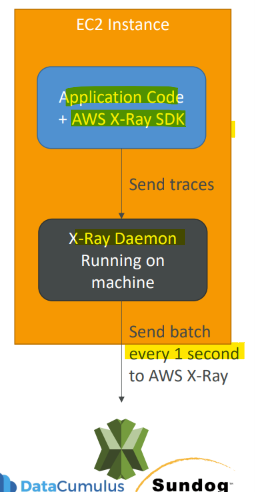

# X-Ray

[Back](../index.md)

- [X-Ray](#x-ray)
  - [X-Ray](#x-ray-1)
    - [Tracing](#tracing)
    - [How to enable it?](#how-to-enable-it)
    - [Troubleshooting](#troubleshooting)

---

## X-Ray

- `AWS X-Ray`
  - a distributed **tracing service** that helps developers **analyze and debug distributed applications**, such as those built using microservices or serverless architectures.
  - tracks **requests end-to-end** as they move across compute services, databases, queues, and external APIs to pinpoint performance bottlenecks and errors.

- **How It Works**
  1. **Instrument**:
     - enable `X-Ray` integration or add X-Ray SDKs/OpenTelemetry instrumentation to your **application code** (supporting languages like Java, Node.js, Python, .NET, Go, and Ruby).
  2. **Collect**:
     - Applications and **integrated** AWS services (such as AWS Lambda, Amazon API Gateway, Amazon EC2, Amazon ECS, and Amazon DynamoDB) **emit trace data** as segments and subsegments.
  3. **Analyze**:
     - X-Ray **assembles traces** and **builds service maps** in the console or via APIs, often working alongside Amazon CloudWatch for broader observability.

- **Key Capabilities**
  - **End-to-end tracing**:
    - **Groups** timing, status codes, and exception data from individual services **into a single trace** for each request.
  - **Service maps**:
    - Generates a **visual dependency graph** showing how services connect and where latency, errors, or faults occur.
  - **Trace filtering and groups**:
    - Lets you **slice traces** using filter expressions, custom annotations, and metadata to isolate specific users, routes, or workflows.
  - **Sampling**:
    - **Controls** how many requests are traced so you can gather representative data without excessive overhead or cost.

---

- **issues** of debugging distributed sysntem
  - Debugging in Production, the good old way:
    - Test locally
    - Add log statements everywhere
    - Re-deploy in production
  - Log formats differ across applications using CloudWatch and analytics is hard.
  - Debugging: monolith “easy”, distributed services “hard”
  - No common views of your entire architecture!

- **benefits**:
  - **Visual analysis** of our applications
  - **Troubleshooting** performance (bottlenecks)
  - Understand **dependencies** in a microservice architecture
  - Pinpoint service **issues**
  - Review **request** behavior
  - Find **errors** and exceptions
  - Are we meeting time **SLA**?
  - Where I am **throttled**?
  - Identify **users** that are impacted

- **compatibility**
  - AWS Lambda
  - Elastic Beanstalk
  - ECS
  - ELB
  - API Gateway
  - EC2 Instances or any application server (even on premise)

---

- `X-Ray` service **collects data** from **all** the different services
- **Service map** is computed from all the segments and traces
- `X-Ray` is **graphical**, so even **non technical people** can help troubleshoot

---

### Tracing

- `Tracing` is an **end to end way** to following a “request”
- **Each component** dealing with the request **adds its own “trace”**
- Tracing is made of `segments` (+ `sub segments`)
- `Annotations` can be added to traces to **provide extra-information**
- Ability to trace:
  - **Every request**
  - **Sample request** (as a % for example or a rate per minute)
- X-Ray **Security**:
  - **IAM** for authorization
  - **KMS** for encryption at rest

---

### How to enable it?

1. Your **code** (Java, Python, Go, Node.js, .NET) **must import** the `AWS X-Ray SDK`
   - Very little code modification needed
   - The application SDK will then **capture**:
     - Calls to AWS services
     - HTTP / HTTPS requests
     - Database Calls (MySQL, PostgreSQL, DynamoDB)
     - Queue calls (SQS)
2. **Install the X-Ray daemon** or **enable** X-Ray AWS **Integration**
   - `X-Ray daemon` works as a low level UDP packet interceptor (Linux / Windows / Mac…)
   - `AWS Lambda` / other AWS services already run the `X-Ray daemon` for you
   - Each application must have the **IAM rights** to write data to X-Ray

---

### Troubleshooting

- If X-Ray is **not** working on `EC2`
  - Ensure the EC2 `IAM Role` has the proper **permissions**
  - Ensure the EC2 **instance** is **running** the `X-Ray Daemon`

- To enable on AWS `Lambda`:
  - Ensure it has an `IAM execution role` with proper **policy** (`AWSX-RayWriteOnlyAccess`)
  - Ensure that X-Ray is **imported in the code**
  - Enable `Lambda X-Ray Active Tracing`
