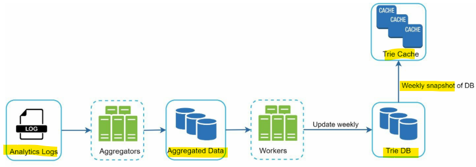
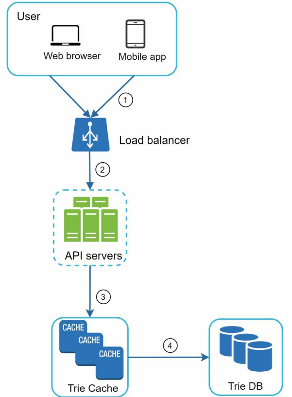
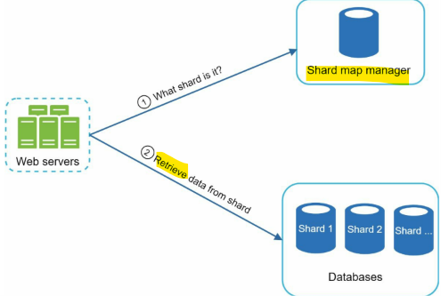

# System Design - Search autocomplete

[Back](../system_design.md)

- [System Design - Search autocomplete](#system-design---search-autocomplete)
  - [Search autocomplete](#search-autocomplete)
  - [Step 1 - Understand the problem and establish design scope](#step-1---understand-the-problem-and-establish-design-scope)
  - [Step 2 - Propose high-level design and get buy-in](#step-2---propose-high-level-design-and-get-buy-in)
    - [Data gathering service](#data-gathering-service)
    - [Query service](#query-service)
  - [Step 3 - Design deep dive](#step-3---design-deep-dive)
    - [Trie data structure](#trie-data-structure)
    - [Data gathering service](#data-gathering-service-1)
    - [Query service](#query-service-1)
    - [Scale the storage](#scale-the-storage)
  - [Step 4 - Wrap up](#step-4---wrap-up)

---

## Search autocomplete

- autocomplete
  - typeahead, search-as-you-type, or incremental search.
  - design top k
  - design top k most searched queries

---

## Step 1 - Understand the problem and establish design scope

- Q:
  - Is the matching only supported at the beginning of a search query or in the middle as well?
    - Only at the beginning of a search query.
  - How many autocomplete suggestions should the system return?
    - 5
  - How does the system know which 5 suggestions to return?
    - determined by popularity, decided by the historical query frequency.
  - Does the system support spell check?
    - No, spell check or autocorrect is not supported.
  - Are search queries in English?
  - Do we allow capitalization and special characters?
  - How many users use the product?
    - 10 million DAU.

- Requirements
  - **Fast** response time:
    - As a user types a search query, autocomplete suggestions must show up fast enough.
  - **Relevant**: Autocomplete suggestions should be relevant to the search term.
  - **Sorted**: Results returned by the system must be sorted by popularity or other ranking models.
  - **Scalable**: The system can handle **high traffic volume**.
  - Highly **available**: The system should remain available and accessible when part of the system is offline, slows down, or experiences unexpected network errors.

- estimation
  - **10 million** daily active users (DAU).
  - An average person performs **10** searches per day.
  - 20 bytes of data per query string:
    - Assume we use ASCII character encoding. 1 character = 1 byte
    - Assume a query contains 4 words, and each word contains 5 characters on average.
    - That is 4 x 5 = 20 bytes per query.

  - ~24,000 query per second (QPS) = 10,000,000 users _ 10 queries / day _ 20 characters / 24 hours / 3600 seconds.
  - Peak QPS = QPS \* 2 = ~48,000
  - Assume 20% of the daily queries are new. 10 million _ 10 queries / day _ 20 byte per query \* 20% = 0.4 GB.
  - This means 0.4GB of new data is added to storage daily.

---

## Step 2 - Propose high-level design and get buy-in

- broken down into two:
  - Data gathering service:
    - gathers user input queries and aggregates them in real-time.
  - Query service:
    - Given a search query or prefix, return 5 most frequently searched terms.

---

### Data gathering service

- frequency table

| field        | description                                |
| ------------ | ------------------------------------------ |
| query_string | query string.                              |
| frequency    | number of times a query has been searched. |

### Query service

- each type, returns top 5

---

## Step 3 - Design deep dive

### Trie data structure

- fetching the top 5 search queries from a relational database is inefficient.
  - solved by data structure trie (prefix tree), tree-like data structure that can compactly store strings.

- skip

---

### Data gathering service

- whenever a user types a search query, data is updated in real-time.
  - not practical
    - Updating the trie on every query significantly slows down the query service.
    - Top suggestions may not change much once the trie is built. Thus, it is unnecessary to update the trie frequently.
- data used to build the trie is usually from analytics or logging services.

- **Analytics Logs**: It stores raw data about search queries.
- **Aggregators:** formats log data
- **Aggregated Data:** “frequency” field is the sum of the occurrences
- **Workers:** build the trie data structure and store it in Trie DB.
- **Trie Cache:** distributed cache system that keeps trie in memory for fast read.
- **Trie DB:** persistent storage
  - can be Key-value store

---

### Query service

1. A search query is **sent** to the load balancer.
2. The load balancer **routes** the request to API servers.
3. API servers get trie data from **Trie Cache** and construct autocomplete suggestions for sthe client.
4. In case the data is **not** in Trie Cache, we replenish data back to the cache.
   - This way, all subsequent requests for the same prefix are returned from the cache. A cache miss can happen when a cache server is out of memory or offline.

- optimizations
  - AJAX request: not refresh the whole web page.
  - Browser caching
  - Data sampling
    - e.g., only 1 out of every N requests is logged by the system.

---

### Scale the storage

- scalability issue when the trie grows too large to fit in one server.

- **shard map manager** maintains a lookup database for identifying where rows should be stored.

---

## Step 4 - Wrap up

- follow up questions:
  - How do you extend your design to support multiple languages?
    - store Unicode characters in trie nodes.
  - What if top search queries in one country are different from others?
    - build different tries for different countries. To improve the response time, we can store tries in CDNs.
