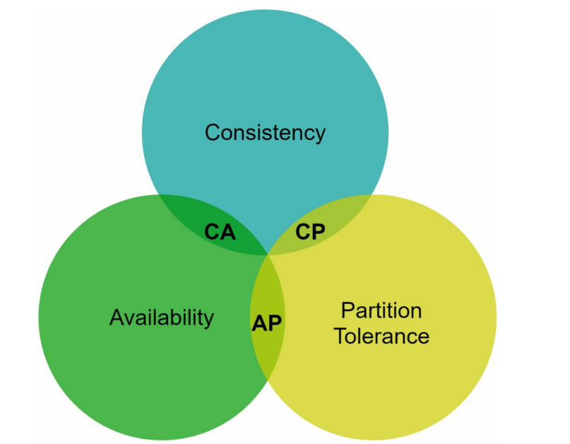
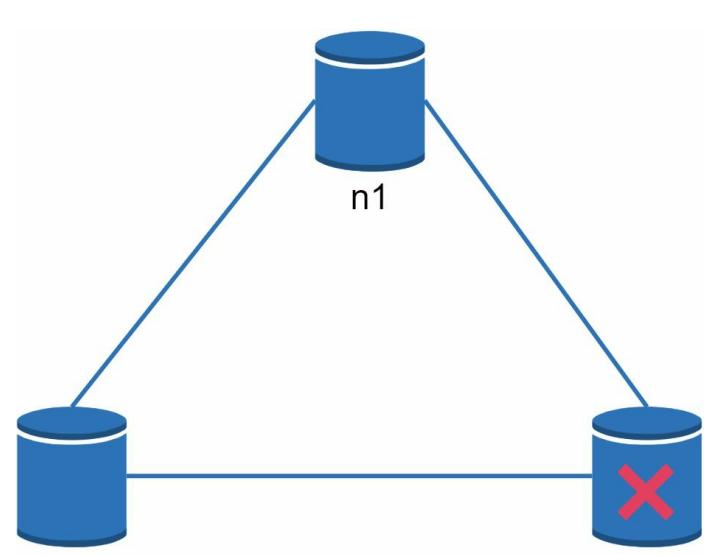

# System Design - Basics

[Back](../system_design.md)

- [System Design - Basics](#system-design---basics)
  - [Key Characteristics of Distributed Systems](#key-characteristics-of-distributed-systems)
    - [Scalability](#scalability)
    - [Reliability](#reliability)
    - [Availability](#availability)
    - [Efficiency](#efficiency)
    - [Serviceability or Manageability](#serviceability-or-manageability)
  - [CAP Theorem](#cap-theorem)
  - [Estimation](#estimation)
    - [Power of two](#power-of-two)
    - [Availability numbers](#availability-numbers)
    - [Estimate example](#estimate-example)

---

## Key Characteristics of Distributed Systems

- Scalability, Reliability, Availability, Efficiency, and Manageability

### Scalability

- `Scalability`
  - the capability of a system, process, or a network **to grow and manage increased demand**.
  - Any distributed system that can **continuously evolve** in order to support the growing amount of work is considered to be `scalable`.

- reasons for Scalability:
  - increased data volume
  - increased amount of work,
    - e.g., number of transactions.

---

- `Horizontal Scaling` vs. `Vertical Scaling`:
  - `Horizontal scaling`: scale by **adding more servers** into pool of resources
    - **easier to scale** dynamically by adding more machines into the existing pool
  - `Vertical scaling`: scale by **adding more power** (CPU, RAM, Storage, etc.) to an **existing server**.
    - usually **limited** to the capacity of a single server
    - often involves **downtime** and comes with an **upper limit**.

---

### Reliability

- `reliability`:
  - the **probability** a system will **fail in a given period**.
  - a distributed system is considered reliable if it **keeps delivering its sservices** even when one or several of its software or hardware **components fail**.
  - achieves this through **redundancy** of both the **software components and data**.
    - If the server carrying the user’s shopping cart fails, another server that has the exact replica of the shopping cart should replace it.

- drawback
  - redundancy has a **cost** and a reliable system has to pay that to achieve such resilience for services by eliminating every single point of failure.

---

### Availability

- `Availability`
  - the time a system **remains operational** to perform its required function **in a specific period**.

- measurement:
  - the **percentage of time** that a system, service, or a machine **remains operational** under normal conditions.

- `Reliability` is `availability` over time

---

- `Reliability` Vs. `Availability`
  - If a system is `reliable`, it is `available`.
    - **high reliability** contributes to **high availability**
  - if it is `available`, it is **not** necessarily `reliable`.
    - but it is possible to achieve a high availability even with an **unreliable** product by **minimizing repair time** and ensuring that spares are always **available** when they are needed.

---

### Efficiency

- measures
  - `latency`: denotes the delay to **obtain the first item**
  - `throughput` / `bandwidth` : denotes the **number of items delivered** in a given time unit (e.g., a second).

---

### Serviceability or Manageability

- `Serviceability` or `manageability`:
  - the **simplicity** and **speed** with which a system can be **repaired or maintained**;
    - if the time to fix a failed system increases, then availability will decrease.
  - the **ease of diagnosing and understanding problems** when they occur, **ease of making updates** or modifications, and **how simple** the system is to operate

- **Early detection** of faults can decrease or avoid system downtime.

---

## CAP Theorem

- `CAP theorem`
  - It is impossible for a distributed software system to **simultaneously** provide **more than two out of three** of the following guarantees (CAP): `Consistency`, `Availability`, and `Partition tolerance`.

- `Consistency`: All nodes see the **same data** at the **same time**.
  - achieved by **updating** several nodes **before** allowing further **reads**
- `Availability`: Every request gets a response on success/failure.
  - achieved by **replicating** the data across different servers.
- `Partition tolerance`: The **system continues** to work despite **message loss or partial failure**.
  - Data is sufficiently **replicated**

---

- `CP (consistency and partition tolerance) systems`:
  - a distributed system supports `consistency` and `partition tolerance` while sacrificing `availability`.

- `AP (availability and partition tolerance) systems`:
  - a distributed system supports `availability` and `partition tolerance` while sacrificing `consistency`.

- `CA (consistency and availability) systems`:
  - a distributed system supports `consistency` and `availability` while sacrificing `partition tolerance`.
  - Since network failure is **unavoidable**, a distributed system **must tolerate** `network partition`.
    - Thus, a CA system **cannot exist** in realworld applications.

---

- Data written to `n1`
  - automatically replicated to `n2` and `n3`
- when a partition occurs, `n3` goes down
  - CP system:
    - must **block all write** operations to `n1` and `n2` to **avoid data inconsistency** among these three servers
    - example: Bank systems
  - AP system:
    - keeps accepting reads, even though it might return **stale data**
    - keeps accepting writes, and data will be **synced** to n3 when the network partition is resolved.

---

## Estimation

### Power of two

- A `byte` is a sequence of 8 `bits`.
- An **ASCII character** uses one `byte` of memory (`8 bits`)

| Power | Approximate value | Full name  | Short name |
| ----- | ----------------- | ---------- | ---------- |
| 10    | 1 Thousand        | 1 Kilobyte | 1 KB       |
| 20    | 1 Million         | 1 Megabyte | 1 MB       |
| 30    | 1 Billion         | 1 Gigabyte | 1 GB       |
| 40    | 1 Trillion        | 1 Terabyte | 1 TB       |
| 50    | 1 Quardillion     | 1 Petabyte | 1 PB       |

---

### Availability numbers

- service level agreement (SLA)
  - agreement between the service provider and customer
  - Amazon, Google, and Microsoft set their SLAs at **99.9%**

- `90% (1 Nine)`: Allows up to 36.5 days of downtime per year.
- `99% (2 Nines)`: Allows up to 3.65 days (87.6 hours) of downtime per year.
- `99.9% (3 Nines)`: Allows up to 8.76 hours of downtime per year.
- `99.99% (4 Nines)`: Allows up to 52.56 minutes of downtime per year.
- `99.999% (5 Nines)`: Allows up to 5.26 minutes of downtime per year.
- `99.9999% (6 Nines)`: Allows up to 31.5 seconds of downtime per year.

---

### Estimate example

Assumptions:

- 300 million monthly active users.
- 50% of users use Twitter daily.
- Users post 2 tweets per day on average.
- 10% of tweets contain media.
- Data is stored for 5 years.

Estimations:

- Query per second (QPS) estimate:
  - Daily active users (DAU) = 300 million \* 50% = 150 million
  - Tweets QPS = 150 million \* 2 tweets / 24 hour / 3600 seconds = ~3500
  - Peek QPS = 2 \* QPS = ~7000
    > multiplier: commonly peak QPS = 2x QPS

- Media storage Estimate:
  - Average tweet size:
    - tweet_id 64 bytes
    - text 140 bytes
    - media 1 MB
  - Media storage per day: 150 million \* 2 \* 10% \* 1 MB = 30 TB
  - 5-year media storage: 30 TB \* 365 \* 5 = ~55 PB
