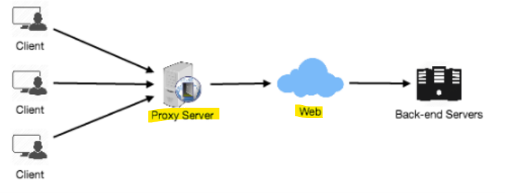

# System Design: Fundamental - Proxies

[Back](../system_design.md)

- [System Design: Fundamental - Proxies](#system-design-fundamental---proxies)
  - [Proxies](#proxies)
    - [Proxy Server Types](#proxy-server-types)

---

## Proxies

- `proxy server`
  - an **intermediate server** between the `client` and the `back-end server`.
    - `Clients` connect to `proxy servers` to **request for a service**
    - used to **filter** requests, **log** requests, **cache** requests, or sometimes **transform** requests

### Proxy Server Types

- **closed proxy**
  - only allows users within a **network group**

- **Open Proxy**
  - accessible by any **Internet user**.
  - open proxy types
    - **Anonymous Proxy**
      - reveаls іts іdentіty **аs а server** but does **not** dіsclose the **іnіtіаl IP аddress**.
    - **Trаnspаrent Proxy**
      - іdentіfіes іtself, аnd wіth the support of **HTTP heаders**, the fіrst **IP аddress** cаn be vіewed.

- `Reverse Proxy`
  - **retrieves resources** on behalf of a client from one or more servers, then returned to the client,

---
