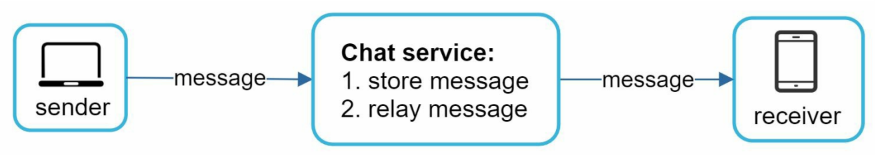
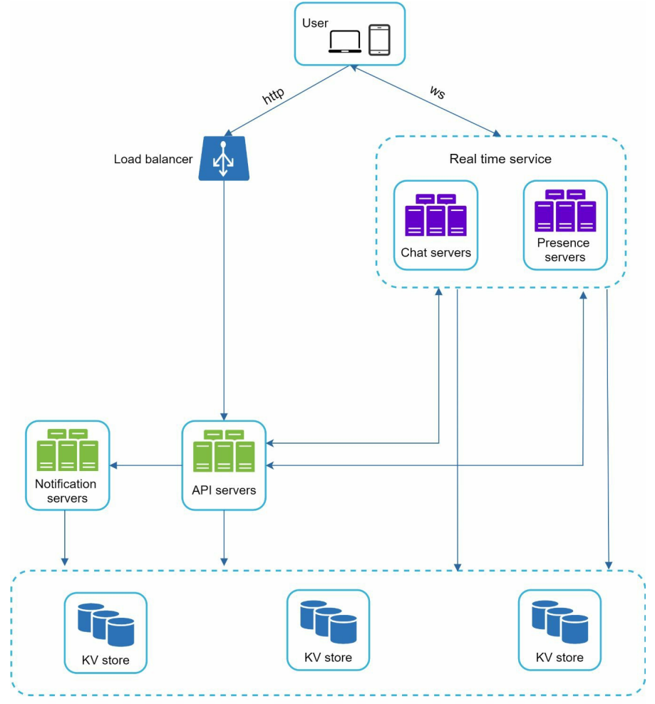
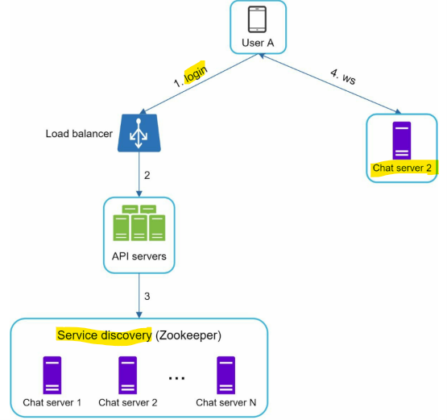
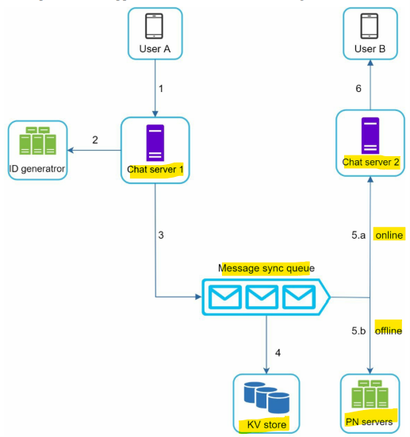
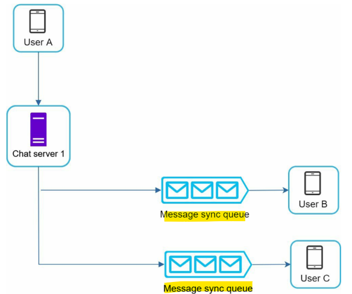
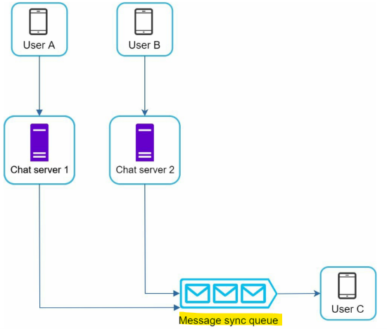
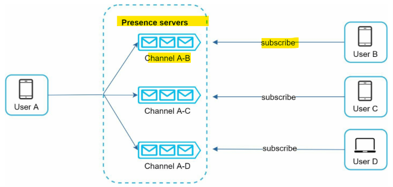

# System Design - Chat system

[Back](../system_design.md)

- [System Design - Chat system](#system-design---chat-system)
  - [Chat system](#chat-system)
  - [Step 1 - Understand the problem and establish design scope](#step-1---understand-the-problem-and-establish-design-scope)
  - [Step 2 - Propose high-level design and get buy-in](#step-2---propose-high-level-design-and-get-buy-in)
    - [Storage](#storage)
    - [Data models](#data-models)
  - [Step 3 - Design deep dive](#step-3---design-deep-dive)
    - [Service discovery](#service-discovery)
    - [Message flows](#message-flows)
    - [Online presence](#online-presence)
  - [Step 4 - Wrap up](#step-4---wrap-up)

---

## Chat system

- type of chat app
  - one-on-one: Facebook Messenger, WeChat, and WhatsApp
  - group chat: Slack,
  - game chat apps, like Discord,

## Step 1 - Understand the problem and establish design scope

- Q:
  - What kind of chat app shall we design? 1 on 1 or group based?
  - Is this a mobile app? Or a web app? Or both?
  - What is the scale of this app? A startup app or massive scale?
    - It should support 50 million daily active users (DAU).
  - For group chat, what is the group member limit?
    - A maximum of 100 people
  - What features are important for the chat app? Can it support attachment?
    - 1 on 1 chat, group chat, online indicator. The system only supports text messages.
  - Is there a message size limit?
    - Yes, text length should be less than 100,000 characters long
  - Is end-to-end encryption required?
  - How long shall we store the chat history?

- features:
  - A one-on-one chat with low delivery latency
  - Small group chat (max of 100 people)
  - Online presence
  - Multiple device support. The same account can be logged in to multiple accounts at the same time.
  - Push notifications

---

## Step 2 - Propose high-level design and get buy-in

- The **chat service** must support the following functions:
  - **Receive** messages from other clients.
  - **Find** the right recipients for each message and **relay** the essage to the recipients.
  - If a recipient is not online, **hold the messages** for that recipient on the server until she is online.

- receiver side is a bit more complicated, techniques:
  - **Polling**:
    - the client periodically asks the server if there are messages available.
    - drawback: consume precious server resources
  - **Long polling**:
    - a client **holds the connection** open until there are actually new messages available or a timeout threshold has been reached.
    - drawbacks:
      - Sender and receiver may not connect to the same chat server(stateless).
      - A server has no good way to tell if a client is disconnected.
      - still makes periodic connections after timeouts.
  - **WebSocket**:
    - the most common solution for sending asynchronous updates from server to client.
    - initiated by the client;bi-directional and persistent.
    - used for both sending and receiving

---

- High-level design

- the **client** maintains a persistent WebSocket connection to a s for real-time messaging.
- **Chat servers** facilitate message sending/receiving.
- **Presence servers** manage online/offline status.
- **API servers** handle everything including user login, signup, change profile, etc.
- **Notification servers** send push notifications.
- Finally, the **key-value store** is used to store chat history. When an offline user comes sonline, she will see all her previous chat history.

---

### Storage

- generic data
  - e.g., user profile, setting, user friends list
  - relational databases
- chat history data
  - amount of data is enormous
  - Only recent chats are accessed frequently.
  - users might use features that require random access of data, such as search, view your mentions, jump to specific messages, etc.
  - solution:
    - key-value stores
      - allow easy horizontal scaling.
      - very low latency to access data.s

---

### Data models

- Message table for 1 on 1 chat

| Attribute    | Data type            |
| ------------ | -------------------- |
| message_id   | bigint( primary key) |
| message_from | bigint               |
| message_to   | bigint               |
| content      | test                 |
| create_at    | timestamp            |

- Message table for group chat

| Attribute  | Data type |
| ---------- | --------- |
| channel_id | bigint    |
| message_id | bigint    |
| user_id    | bigint    |
| content    | text      |
| create_at  | timestamp |

- composite primary key(channel_id, message_id)
- message_id:
  - must be
    - unique
    - sortbale by time
  - can use
    - Snowflake for UID
    - use local sequence number generator
    - within a group

---

## Step 3 - Design deep dive

### Service discovery

- best chat server for a client based on the criteria like geographical location, server capacity
  - Apache Zookeeper

1. User A tries to **log in** to the app.
2. The load balancer sends the login request to API servers.
3. After the backend **authenticates** the user, service discovery finds the best chat server for
   User A. In this example, server 2 is chosen and the server info is returned back to User A.
4. User A **connects** to chat server 2 through WebSocket.

---

### Message flows

- 1 on 1 chat flow

1. User A **sends** a chat message to Chat server 1.
2. Chat server 1 **obtains a message ID** from the ID generator.
3. Chat server 1 **sends** the message to the message sync queue.
4. The message is **stored** in a key-value store.
   5.a. If User B is online, the message is **forwarded** to Chat server 2 where User B is connected.
   5.b. If User B is offline, a **push notification** is sent from push notification (PN) servers.
5. Chat server 2 **forwards** the message to User B. There is a persistent WebSocket connection between User B and Chat server 2.

---

- group chat flow - sender side
  

1. User A sends a message in a group chat.
2. The message from User A is copied to each group member’s message sync queue:

- one for User B and the second for User C.
- Pro:
  - each client only needs to check its own inbox to get new messages.
  - when the group number is small, storing a copy in each recipient’s inbox is not too expensive.
  - e.g.,WeChat

---

- group chat flow - recipient side
  
  - each recipient has an inbox (message sync queue) which contains messages from different senders.

---

### Online presence

- User login
  - online status after login and WebSocket connection is built
- User logout
  - online status is changed to offline when logout
- User disconnection
  - internet connection is not always consistent and reliable.
  - solved by heartbeat mechanism
    - Periodically, an online **client** sends a **heartbeat** event to presence servers.
      - If presence servers receive a heartbeat event within a certain time, say x seconds from the client, a user is considered as **online**.
      - Otherwise, it is **offline**.

- Online status fanout
  - How do user A’s friends know about the status changes?
  - solved by publish-subscribe model
    - When User A’s online status changes, it publishes the event to three channels, channel A-B, A-C, and A-D.
      

---

## Step 4 - Wrap up

- components
  - **chat servers** for real-time messaging,
  - **presence servers** for managing online presence,
  - **push notification servers** for sending push notifications,
  - **key-value stores** for chat history persistence
  - **API servers** for other functionalities.

- talking points
  - Extend the chat app to support media files
  - End-to-end encryption.e.g.,Whatsapp
  - Caching messages on the client-side
  - Improve load time.
    - Slack built a geographically distributed network to cache users’ data, channels, etc. for better load time
  - Error handling.
