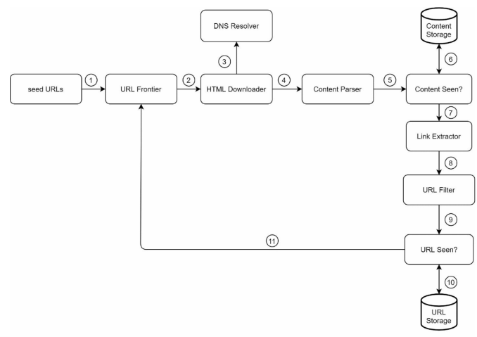

# System Design - Web Crawler

[Back](../system_design.md)

- [System Design - Web Crawler](#system-design---web-crawler)
  - [Web Crawler](#web-crawler)
  - [Step 1 - Understand the problem and establish design scope](#step-1---understand-the-problem-and-establish-design-scope)
  - [Step 2 - Propose high-level design and get buy-in](#step-2---propose-high-level-design-and-get-buy-in)
  - [Step 3 - Design deep dive](#step-3---design-deep-dive)
    - [DFS vs BFS](#dfs-vs-bfs)
    - [URL frontier](#url-frontier)
    - [HTML Downloader](#html-downloader)
    - [Detect and avoid problematic content](#detect-and-avoid-problematic-content)
  - [Step 4 - Wrap up](#step-4---wrap-up)

---

## Web Crawler

- web crawler
  - a robot or spider widely used by search engines to discover new or updated content on the web.
  - starts by collecting a few web pages and then follows links on those pages to collect new content

## Step 1 - Understand the problem and establish design scope

- Q:
  - What is the main purpose of the crawler? Is it used for search engine indexing, data mining, or something else?
    - Search engine indexing.
  - How many web pages does the web crawler collect per month?
    - 1 billion pages.
  - What content types are included? HTML only or other content types such as PDFs and images as well?
    - HTML only.
  - Shall we consider newly added or edited web pages?
  - Do we need to store HTML pages crawled from the web?
  - How do we handle web pages with duplicate content?

- characteristics of a good web crawler
  - Scalability: The web is very large. There are **billions** of web pages out there. Web crawling should be extremely efficient using **parallelization**.
  - Robustness: The web is full of traps. Bad HTML, unresponsive servers, crashes, malicious links, etc. are all common. The crawler must handle all those **edge cases**.
  - Politeness: The crawler should not make too many requests to a website within a short time interval.
  - Extensibility: The system is flexible so that minimal changes are needed to **support new content types**. For example, if we want to crawl image files in the future, we should not need to redesign the entire system.

- estimation
  - Assume 1 billion web pages are downloaded every month.
    - QPS: 1,000,000,000 / 30 days / 24 hours / 3600 seconds = ~400 pages per second.
    - Peak QPS = 2 \* QPS = 800
  - Assume the average web page size is 500k.
    - 1-billion-page x 500k = 500 TB storage per month. If you are unclear about digital storage units, go through “Power of 2” section in Chapter 2 again.
    - Assuming data are stored for five years, 500 TB \* 12 months \* 5 years = 30 PB. A 30 PB storage is needed to store five-year content.

---

## Step 2 - Propose high-level design and get buy-in

- Step 1: Add seed URLs to the `URL Frontier`( First-in-First-out (FIFO) queue)
- Step 2: `HTML Downloader` fetches a list of URLs from `URL Frontier`.
- Step 3: `HTML Downloader` gets IP addresses of URLs from DNS resolver and starts downloading.
- Step 4: `Content Parser` parses HTML pages and checks if pages are malformed.
- Step 5: After content is parsed and validated, it is passed to the `Content Seen?` component.
- Step 6: `Content Seen` component checks if a HTML page is already in the storage.
  - If it is in the storage, this means the same content in a different URL has already been processed. In this case, the HTML page is **discarded**.
  - If it is not in the storage, the system has not processed the same content before. The content is passed to `Link Extractor`.
- Step 7: `Link extractor` extracts links from HTML pages.
- Step 8: Extracted links are passed to the `URL filter`.
- Step 9: After links are filtered, they are passed to the `URL Seen?` component.
- Step 10: `URL Seen` component checks if a URL is already in the storage, if yes, it is processed before, and nothing needs to be done.
- Step 11: If a URL has not been processed before, it is **added** to the `URL Frontier`.

---

## Step 3 - Design deep dive

### DFS vs BFS

- `Depth-First Search (DFS)`
  - Explores as far as possible down one branch before backtracking.
  - Stack or Recursion (Last-In, First-Out / LIFO)
  - Memory: Lower (stores only the current path and siblings).

- `Breadth-First Search (BFS)`
  - Explores level by level
  - Queue (First-In, First-Out / FIFO)
  - Memory: Higher (stores entire level/frontier at once).
  - commonly used by web crawlers
  - drawback:
    - target will be flooded with requests.

---

### URL frontier

- `URL frontier`
  - a data structure that stores URLs to be downloaded.

- Politeness
  - to download one page at a time from the same host.
  - A delay can be added between two download tasks.

- Priority
- Freshness
- Storage for URL Frontier

---

### HTML Downloader

- Robots.txt
- Performance optimization
  - crawl jobs are distributed into multiple servers, and each server runs multiple threads.
    - each downloader is responsible for a subset of the URLs.
  - Cache DNS Resolver
  - Cache DNS Resolver: Distribute crawl servers geographically.
  - Short timeout: If a host does not respond within a predefined time, the crawler will stop the job and crawl some other pages.
- Robustness
  - Consistent hashing
  - Save crawl states and data
  - Exception handling
  - Data validation
- Extensibility
  - support new content types

---

### Detect and avoid problematic content

- Redundant content
  - Hashes or checksums help to detect duplication
- Spider traps: no onesize-fits-all solution exists to detect spider traps.
- Data noise: advertisements, code snippets, spam URLs, etc.

---

## Step 4 - Wrap up

- relevant talking points
  - Server-side rendering:
    - to retrieve dynamically generated links.
    - render before parsing
  - Filter out unwanted pages: anti-spam component
  - Database replication and sharding
  - Horizontal scaling
  - Analytics
