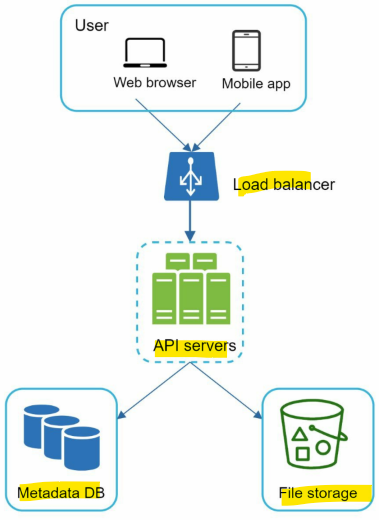
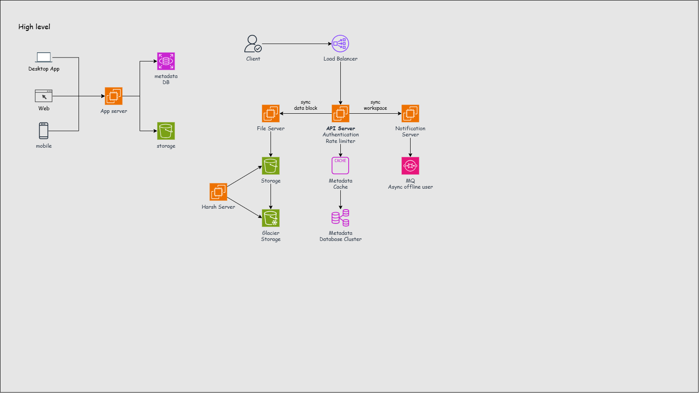
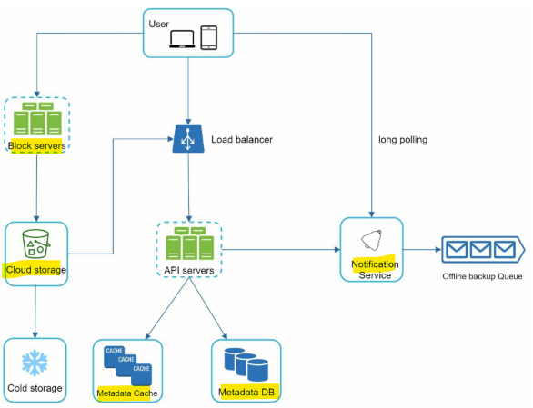
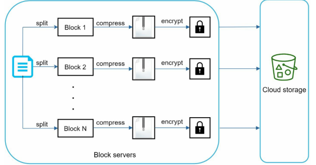
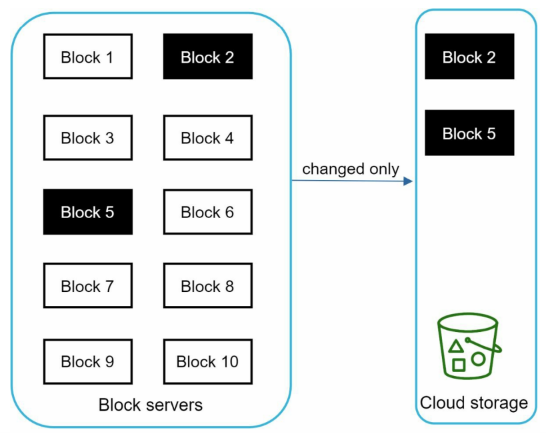

# System Design - Cloud file storage

[Back](../system_design.md)

- [System Design - Cloud file storage](#system-design---cloud-file-storage)
  - [Cloud file storage](#cloud-file-storage)
  - [Steps](#steps)
    - [Step 1 - Requirements](#step-1---requirements)
      - [Estimation](#estimation)
    - [Step 2 - API \& UI](#step-2---api--ui)
    - [Step 3 - Database](#step-3---database)
    - [Step 4 - high level](#step-4---high-level)
    - [Step 5 - Detailed design](#step-5---detailed-design)
      - [Reliability \& HA](#reliability--ha)
      - [Performance](#performance)
      - [Security](#security)
      - [Specific issues](#specific-issues)
      - [Diagram](#diagram)
    - [Step 6 - Wrap up](#step-6---wrap-up)
  - [Reference](#reference)
    - [High level](#high-level)
  - [Step 3 - Design deep dive](#step-3---design-deep-dive)
    - [Block servers](#block-servers)
    - [High consistency requirement](#high-consistency-requirement)
    - [Save storage space](#save-storage-space)

---

## Cloud file storage

- cloud storage services such as `Google Drive`, `Dropbox`, `Microsoft OneDrive`, and `Apple iCloud`

## Steps

### Step 1 - Requirements

- Q:
  - What are the most important features?
    - Upload and download files, file sync, and notifications.
  - Is this a mobile app, a web app, or both?
    - Both
  - What are the supported file formats?
    - Any file type.
  - Do files need to be encrypted?
  - Is there a file size limit?
    - Yes, files must be 10 GB or smaller.
  - How many users does the product have?
    - 10M DAU.
- R:
  - Add files
  - Download files.
  - Sync files across multiple devices.
  - See file revisions.
  - Share files with your friends, family, and coworkers
  - Send a notification when a file is edited, deleted, or shared with you.
- non-functional:
  - performance
  - reliability & HA
  - security

---

#### Estimation

- **Assume**
  - user: 50M
  - DAU: 10M
  - available free space: 10GB
  - average upload files per day: 2 files
  - average file size: 500KB
  - R/W: 1:1
- **Traffic estimates**
  - avg read/write /s: 2files \* 10M / (3600\*24) = 230/s
  - peak QPS: 2 \* avg QPS = 460/s
- **Storage**
  - Total space: 50M \* 10GB = 500 PB
- **Bandwith**
  - read/write: 230/s \* 500KB = 115MB

---

### Step 2 - API & UI

- UI:
  - desktop app (agent)
  - web
  - mobile

---

- feature: upload file
  - `POST /api/v1/upload/`
  - header: `api-token`
  - param (body): chunked files

---

- feature: check sync
  - `GET /api/v1/sync`
  - header: `api-token`
  - param: fs hash
  - return:
    - []: empty is sync
    - unsync list: if unsync

---

- feature: download file
  - `GET /api/v1/download/{file_id}`
  - header: `api-token`
  - param: file_id
  - return:
    - file

---

### Step 3 - Database

- **User table**

| field     | data type | desc          |
| --------- | --------- | ------------- |
| `user_id` | int       | user id       |
| `email`   | varchar2  | email address |

- file system metadata

| field        | data type | DESC               |
| ------------ | --------- | ------------------ |
| `uuid`       | uuid      | unique id          |
| `user_id`    | int       | user id            |
| `storage_id` | varchar   | storage id(s3 arn) |
| `create_at`  | datetime  | creation datetime  |

---

### Step 4 - high level

- high level api
  

---

### Step 5 - Detailed design

#### Reliability & HA

- Issue: SPOF due to app server
  - Solution: **load balancing**
    - Route traffic to healthy app servers across availability zones.

- Issue: DB SPOF
  - Solution: **database replication**
    - master-replica; standby promote to master

- Issue: data loss of storage
  - Solution: **Replication and recovery**
    - Use multi-AZ object storage for failover.

---

#### Performance

- Issue: file delivery leads to latency
  - Solution: **Separate metadata from file system**
    - file server for file sync
    - metadata server for metadata sync

---

#### Security

- Issue: unauthorized media access
  - Solution: **Token authentication**
    - Require `api-token` for uploads, follows, and feed reads. Keep object storage private.
    - Check current visibility and viewer access for restricted media, search results, and feed items.
- Issue: abusive traffic
  - Solution: **Rate limiting**
    - Limit paste creation and repeated requests for invalid codes.

---

#### Specific issues

- Issue: Sync conflicts on same file
  - Solution: **first modification wins**
    - the first version that gets processed wins, and the version that gets processed later receives a conflict.

- Issue: file sync; entire file or data block
  - Solution: **chunck files into data block**
    - sync only the unsync data block

- Issue: file changes monitoring
  - Solution: **client side agent**
    - local agent:
      - manage local metadata database
      - harsh file: to check whether get changed
      - Sync local metedata DB with remote metedata DB
      - chunck file into data block
      - compress data block to utilize bandwidth
      - Sync data block

- Issue: manage the growth of storage
  - Solution: **harsh data block**
    - local: harsh data block
    - remote: check if harsh already exists
      - if so, only update the reference
      - if not, upload data block

- Issue: how to connection remote metadata db; leadind to overhead
  - Solution: **period + long polling**
    - local: monitor and update local metadata periodically
    - connect with remote: long polling
      - reduce TCP overhead

- Issue: cost due to high volume storage
  - Solution: **storage tier**
    - background process: hot -> infrequent access -> glacier

- Issue: offline user sync
  - Solution: **MQ subscriber**
    - local agent store local file system modification
    - Sync when back online
    - MQ async the data sync

---

#### Diagram

---

### Step 6 - Wrap up

- feature
  - functional
  - non-functional
- resolved vs open-end
- road map

---

## Reference

### High level

- **Block servers**: Block servers upload blocks to cloud storage.
- **Cloud storage**: A file is split into smaller blocks and stored in cloud storage.
- **Cold storage**: Cold storage is a computer system designed for storing inactive data
- **API servers**: API servers are used for user authentication, managing user profile, updating file metadata, etc.
- **Metadata database**: It stores metadata of users, files, blocks, versions, etc.
- **Metadata cache**: Some of the metadata are cached for fast retrieval.
- **Notification service**: notification
  service notifies relevant clients when a file is added/edited/removed elsewhere so they can pull the latest changes.
- **Offline backup queue**: If a client is offline and cannot pull the latest file changes, the offline
  backup queue stores the info so changes will be synced when the client is online.

---

## Step 3 - Design deep dive

### Block servers

- sending the **whole file** on each update consumes a lot of **bandwidth**.
  - optimizations
    - Delta sync. When a file is modified, only modified blocks are synced instead of the whole file using a sync algorithm
    - Compression

- A file is **split** into smaller blocks.
- Each block is **compressed** using compression algorithms.
- To ensure security, each block is **encrypted** before it is sent to cloud storage.
- Blocks are **uploaded** to the cloud storage.

- only modified blocks are transferred

---

### High consistency requirement

- To achieve strong consistency, we must ensure the
  following:
  - Data in cache replicas and the master is consistent.
  - Invalidate caches on database write to ensure cache and database hold the same value

- Use relational database, it maintains the ACID(Atomicity, Consistency, Isolation, Durability) properties

---

### Save storage space

- De-duplicate data blocks
  - Two blocks are identical if they have the same hash value.
  - Eliminating redundant blocks at the account level
- Adopt an intelligent data backup strategy.
  - set a limit for the number of versions to store
    - the oldest version will be replaced with the new version
- Moving infrequently used data to cold storage
  - Amazon S3 glacier

---
