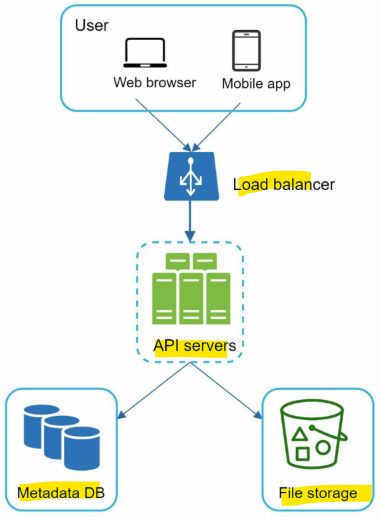
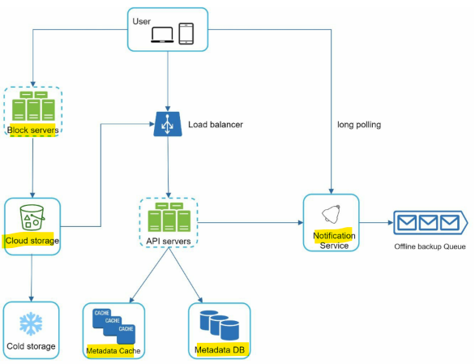
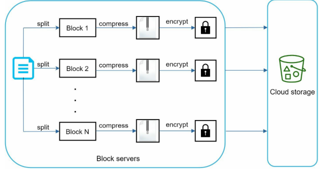
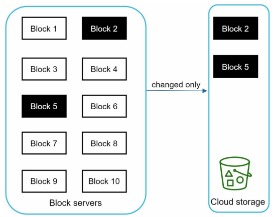

# System Design - Google Drive

[Back](../system_design.md)

- [System Design - Google Drive](#system-design---google-drive)
  - [Google Drive](#google-drive)
  - [Step 1 - Understand the problem and establish design scope](#step-1---understand-the-problem-and-establish-design-scope)
  - [Step 2 - Propose high-level design and get buy-in](#step-2---propose-high-level-design-and-get-buy-in)
    - [API](#api)
    - [Sync conflicts](#sync-conflicts)
    - [High level](#high-level)
  - [Step 3 - Design deep dive](#step-3---design-deep-dive)
    - [Block servers](#block-servers)
    - [High consistency requirement](#high-consistency-requirement)
    - [Save storage space](#save-storage-space)
  - [Step 4 - Wrap up](#step-4---wrap-up)

---

## Google Drive

- cloud storage services such as Google Drive, Dropbox, Microsoft OneDrive, and Apple iCloud

## Step 1 - Understand the problem and establish design scope

- Q:
  - What are the most important features?
    - Upload and download files, file sync, and notifications.
  - Is this a mobile app, a web app, or both?
    - Both
  - What are the supported file formats?
    - Any file type.
  - Do files need to be encrypted?
  - Is there a file size limit?
    - Yes, files must be 10 GB or smaller.
  - How many users does the product have?
    - 10M DAU.
- R:
  - Add files
  - Download files.
  - Sync files across multiple devices.
  - See file revisions.
  - Share files with your friends, family, and coworkers
  - Send a notification when a file is edited, deleted, or shared with you.
- non-functional:
  - Reliability
  - Fast sync speed.
  - Bandwidth usage
  - Scalability
  - High availability

- estimation
  - Assume the application has 50 million signed up users and **10 million** DAU.
  - Users get **10 GB** free space.
  - Assume users upload 2 files per day. The average file size is 500 KB.
  - 1:1 read to write ratio.
  - Total space allocated: 50 million \* 10 GB = 500 Petabyte
  - QPS for upload API: 10 million \* 2 uploads / 24 hours / 3600 seconds = ~ 240
  - Peak QPS = QPS \* 2 = 480

---

## Step 2 - Propose high-level design and get buy-in

- start with a single server

### API

- 1. Upload a file
  - Two types of uploads
    - Simple upload: file size is small.
    - Resumable upload: file size is large; high chance of network interruption
- 2. Download a file
- 3. Get file revisions

- use HTTPS. Secure Sockets Layer (SSL) protects data transfer

---

- from distributed system
- Storage
  - option1: share storage on multiple storage servers
    - data loss
  - option2: Amazon S3(replication)

---

- high level api
  

---

### Sync conflicts

- the first version that gets processed wins, and the version that gets processed later receives a conflict.

---

### High level

- **Block servers**: Block servers upload blocks to cloud storage.
- **Cloud storage**: A file is split into smaller blocks and stored in cloud storage.
- **Cold storage**: Cold storage is a computer system designed for storing inactive data
- **API servers**: API servers are used for user authentication, managing user profile, updating file metadata, etc.
- **Metadata database**: It stores metadata of users, files, blocks, versions, etc.
- **Metadata cache**: Some of the metadata are cached for fast retrieval.
- **Notification service**: notification
  service notifies relevant clients when a file is added/edited/removed elsewhere so they can pull the latest changes.
- **Offline backup queue**: If a client is offline and cannot pull the latest file changes, the offline
  backup queue stores the info so changes will be synced when the client is online.

---

## Step 3 - Design deep dive

### Block servers

- sending the **whole file** on each update consumes a lot of **bandwidth**.
  - optimizations
    - Delta sync. When a file is modified, only modified blocks are synced instead of the whole file using a sync algorithm
    - Compression

- A file is **split** into smaller blocks.
- Each block is **compressed** using compression algorithms.
- To ensure security, each block is **encrypted** before it is sent to cloud storage.
- Blocks are **uploaded** to the cloud storage.

- only modified blocks are transferred

---

### High consistency requirement

- To achieve strong consistency, we must ensure the
  following:
  - Data in cache replicas and the master is consistent.
  - Invalidate caches on database write to ensure cache and database hold the same value

- Use relational database, it maintains the ACID(Atomicity, Consistency, Isolation, Durability) properties

---

### Save storage space

- De-duplicate data blocks
  - Two blocks are identical if they have the same hash value.
  - Eliminating redundant blocks at the account level
- Adopt an intelligent data backup strategy.
  - set a limit for the number of versions to store
    - the oldest version will be replaced with the new version
- Moving infrequently used data to cold storage
  - Amazon S3 glacier

---

## Step 4 - Wrap up
