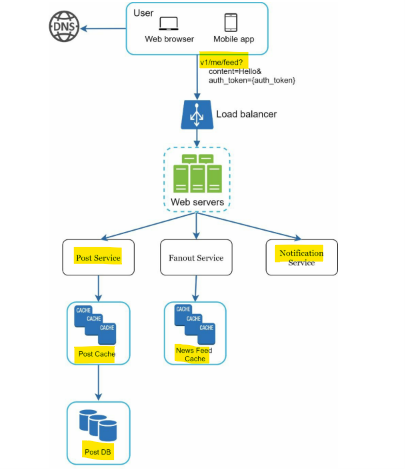
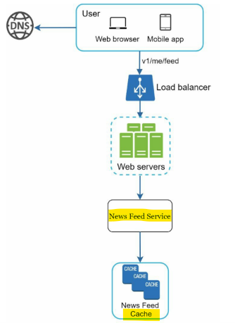
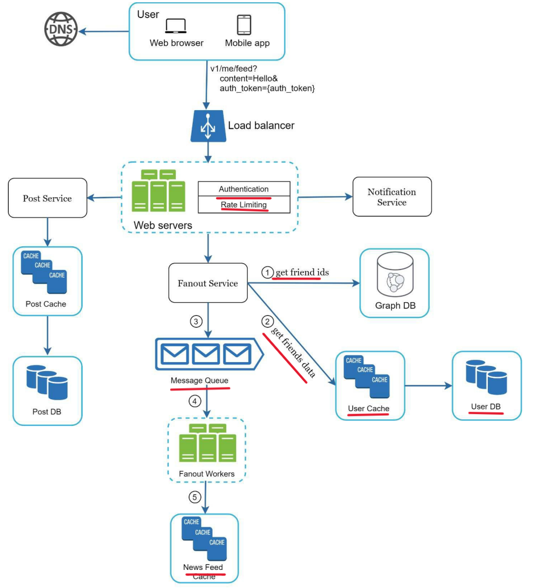
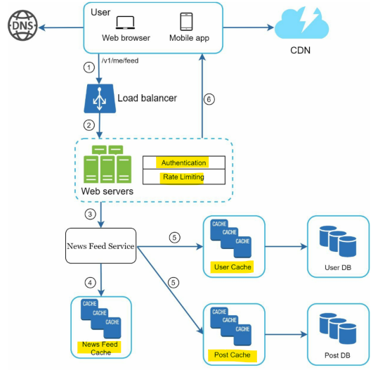

# System Design - News Feed System

[Back](../system_design.md)

- [System Design - News Feed System](#system-design---news-feed-system)
  - [News Feed System](#news-feed-system)
  - [Step 1 - Understand the problem and establish design scope](#step-1---understand-the-problem-and-establish-design-scope)
  - [Step 2 - Propose high-level design and get buy-in](#step-2---propose-high-level-design-and-get-buy-in)
    - [Newsfeed APIs](#newsfeed-apis)
    - [feed publishing flow](#feed-publishing-flow)
    - [Newsfeed building](#newsfeed-building)
  - [Step 3 - Design deep dive](#step-3---design-deep-dive)
    - [Feed publishing deep dive](#feed-publishing-deep-dive)
    - [Newsfeed retrieval deep dive](#newsfeed-retrieval-deep-dive)
  - [Step 4 - Wrap up](#step-4---wrap-up)

---

## News Feed System

- `news feed`
  - a **constantly updating digital stream** of headlines, articles, posts, and real-time updates displayed on a web page or mobile app screen.

- Similar questions commonly asked are:
  - design Facebook news feed
  - Instagram feed
  - Twitter timeline, etc.

---

## Step 1 - Understand the problem and establish design scope

- Q:
  - Is this a mobile app? Or a web app? Or both?
  - What are the important features?
    - A user can publish a post and see her friends’ posts on the news feed page.
  - Is the news feed sorted by reverse chronological order or any particular order such as topic scores? For instance, posts from your close friends have higher scores.
    - assume the feed is sorted by reverse chronological order.
  - How many friends can a user have?
    - 5000
  - What is the traffic volume?
    - 10 million DAU
  - Can feed contain images, videos, or just text?

---

## Step 2 - Propose high-level design and get buy-in

- The design is divided into two flows: feed publishing and news feed building

### Newsfeed APIs

- Feed publishing API: publish a post
  - `POST /v1/me/feed`
  - param:
    - content
    - api token
- Newsfeed retrieval API: retrieve news feed
  - `GET /v1/me/feed`
  - param:
    - api token

### feed publishing flow

- Web servers: web servers redirect traffic to different internal services.
- **Post service**: **persist** post in the database and cache
- **Fanout service**: push **new content** to friends’ news feed. Newsfeed data is stored in the **cache** for fast retrieval.
- **Notification service**: **inform** friends that new content is available and send out push notifications.

---

### Newsfeed building

- **Web servers**: web servers **route** requests to newsfeed service.
- **Newsfeed service**: news feed service **fetches** news feed from the cache.
- **Newsfeed cache**: store **news** feed IDs needed to render the news feed.

---

## Step 3 - Design deep dive

### Feed publishing deep dive

- **Web servers**: authentication and rate-limiting
- **Fanout service**: the process of delivering a post to all friends.
  - 1. Fetch friend IDs from the graph database.
  - 2. Get friends info from the user cache.
  - 3. Send friends list and new post ID to the **message queue**.
  - 4. Fanout workers fetch data from the message queue and store news feed data in the news feed cache.
  - 5. Store <post_id, user_id > in news feed cache.

---

- Fanout models:
  - push model: fanout on write
    - news feed is pre-computed **during write time**.
    - A new post is delivered to friends’ cache **immediately after it is published**.
    - pro:
      - Fetching news feed is fast
    - con:
      - generating news feeds for all of them are slow and time consuming.
      - For inactive users or those rarely log in, pre-computing news feeds waste computing resources.

  - pull model: fanout on read
    - generated during read time
    - Recent posts are pulled when a user loads her home page.
    - pro:
      - not waste computing resources on inactive users
    - Cons:
      - Fetching the news feed is slow
  - hybrid approach
    - push model for the majority of userss

---

### Newsfeed retrieval deep dive

1. A user sends a request to **retrieve** her news feed. The request looks like this: /v1/me/feed
2. The load balancer redistributes requests to web servers.
3. Web servers call the news feed service to fetch news feeds.
4. **News feed service** gets a list post IDs from the news feed cache.
5. A user’s news feed is more than just a list of feed IDs. It contains username, profile picture, post content, post image, etc.
   - Thus, the news feed service **fetches the complete user and post objects** from caches (user cache and post cache) to construct the fully hydrated news feed.
6. The fully hydrated news feed is returned in JSON format back to the client for rendering.

---

## Step 4 - Wrap up

- high-level talking points
  - Scaling the database:
    - Vertical scaling vs Horizontal scaling
    - SQL vs NoSQL
    - Master-slave replication
    - Read replicas
    - Consistency models
    - Database sharding
  - Keep web tier stateless
  - Cache data as much as you can
  - Support multiple data centers
  - Lose couple components with message queues
  - Monitor key metrics.
    - For instance, QPS during peak hours and latency while users refreshing their news feed are interesting to monitor.
