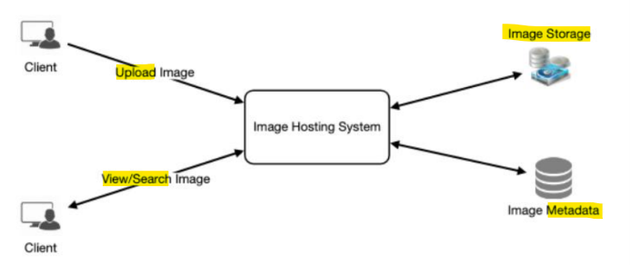

# System Design - Instagram

[Back](../system_design.md)

- [System Design - Instagram](#system-design---instagram)
  - [Instagram](#instagram)
  - [Steps](#steps)
    - [Step 1 - Requirements](#step-1---requirements)
    - [Step 2 - API](#step-2---api)
    - [Step 3 - Database](#step-3---database)
    - [Step 4 - High level](#step-4---high-level)
    - [Step 5 - Detailed design](#step-5---detailed-design)
      - [Feed](#feed)
    - [Step 6 - Wrap up](#step-6---wrap-up)

---

## Instagram

- `Instagram`
  - a social networking service which enables its users to **upload and share their photos and videos** with other users.

---

## Steps

### Step 1 - Requirements

**Functional Requirements**

1. Users should be able to **upload/download/view photos**.
2. Users can **perform searches** based on photo/video titles.
3. Users can **follow** other users.
4. The system should be able to generate and display a user’s **News Feed** consisting of top photos from all the people the user follows.

**Non-functional Requirements**

1. Our service needs to be **highly available**.
2. The acceptable **latency** of the system is **200ms** for News Feed generation.
3. **Consistency** can take a hit (in the interest of availability), if a user doesn’t see a photo for a while; it should be fine.
4. The system should be highly **reliable**; any uploaded photo or video **should never be lost**.

**Not in scope**:

- Adding tags to photos
- searching photos on tags
- commenting on photos
- tagging users to photos, who to follow, etc.

---

- **Estimation**
  - assume
    - total users: 500M
    - DAU: 1M
    - new photos every day: 2M
    - new photos every second: 23
    - Average photo file size: 200KB
  - **Traffic estimates**
    - read: 1M / (3600\*24) = 12 /s
    - write: 23/s
  - **Storage**
    - photos per day: 2M \* 200KB = 400GB
    - 10 years: 400GB \* 365 \* 10 = 1.4PB
  - **Bandwith**
    - read: 12/s \* 200KB = 2.4 MB
    - write: 23/s \* 200KB = 2.6 MB
  - **UUID**
    - photos id: 2M/day \* 365 \* 10 = 7.3B

---

### Step 2 - API

- feature: upload photo
- `POST /api/v1/upload`
  - header: api_token
  - param:
    - user_id
    - image_data
  - return:
    - image_id
    - 200

---

- feature: get/download photo
- `GET /api/v1/photo`
  - header: api_token optional for private user
  - param:
    - image_id
  - return:
    - image_data
    - 200

---

- feature: search photo
- `GET /api/v1/photo?s=<kw>`
  - header: api_token optional for private user
  - param:
    - key_word
    - page default=20
  - return:
    - image_id list
    - 200

---

### Step 3 - Database

- User

| Field   | datatype | desc    |
| ------- | -------- | ------- |
| user_id | int      | user id |
| email   | varchar2 | email   |

- image metadata

| Field   | datatype | desc      |
| ------- | -------- | --------- |
| uuid    | int      | unique id |
| user_id | int      | user id   |
| img_url | varchar2 | image url |

- follows

| Field     | datatype | desc             |
| --------- | -------- | ---------------- |
| user_id   | int      | user id          |
| follow_id | int      | followed user id |

- NoSQL:
  - large scale;
  - allow eventual consistency

---

### Step 4 - High level

- Evaluate:
  - upload
  - view
  - search

---

### Step 5 - Detailed design

- High availability: removing SPOF
  - LB
  - replicas
    - database: master-standby
    - image storage: copy

- uploading is resouce consuming
  - separate:
    - upload server
    - download server

- database:
  - big volume 1.4B
    - shard
  - follower relation:
    - graph db: neo4j

- high performance:
  - CDN: distributed photo
  - cache:
    - feed
    - eviction policy: Least Recently Used (LRU) discard the least recently viewed row first.

- photo_id
  - dedicated service: KGS + snowflake(sortable for feed)

- Flowchart
  - write: 
    - client -> LB -> upload server -> KGS(get UUID) -> LB -> object storage -> -> LB -> DB
  - read: 
    - client -> LB -> download server -> LB -> DB -> LB -> object storage
  - search: 
    - client -> LB -> search server -> LB -> DB

---

#### Feed

- feed: fetch the latest
  - feed server:
    - pre-generate after uploading
    - push-model + UI minimal alert

- Feed take times; reliable
  - MQ

- Feed performance:
  - cache

- Flowchart
  - upload -> feed server -> get followers from graph DB -> get user info -> get photo url -> MQ -> feed worker generate feed -> cache feed

---

### Step 6 - Wrap up

- talking point:
  - celebrity data grow
    - monitoring
    - maintainant: move to new shard
