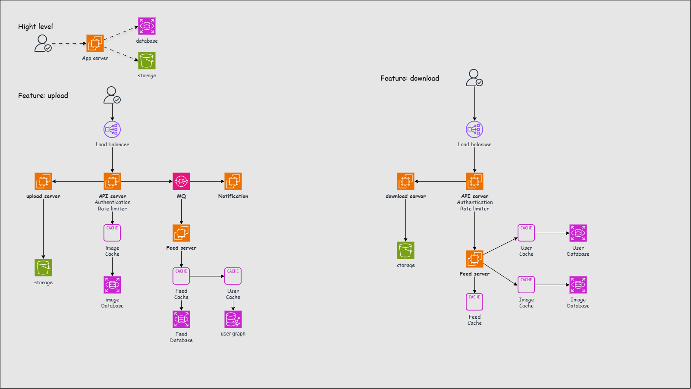

# System Design - Instagram

[Back](../system_design.md)

- [System Design - Instagram](#system-design---instagram)
  - [Instagram](#instagram)
  - [Steps](#steps)
    - [Step 1 - Requirements](#step-1---requirements)
      - [Estimation](#estimation)
    - [Step 2 - API](#step-2---api)
    - [Step 3 - Database](#step-3---database)
    - [Step 4 - High level](#step-4---high-level)
    - [Step 5 - Detailed design](#step-5---detailed-design)
      - [Performance](#performance)
      - [Reliability and availability](#reliability-and-availability)
      - [Security](#security)
      - [Specific issues](#specific-issues)
      - [Feed](#feed)
      - [Flowchart](#flowchart)
    - [Step 6 - Wrap up](#step-6---wrap-up)

---

## Instagram

- `Instagram`
  - a social networking service which enables its users to **upload and share their photos and videos** with other users.

---

## Steps

### Step 1 - Requirements

**Functional Requirements**

1. Users should be able to **upload/download/view photos**.
2. Users can **perform searches** based on photo/video titles.
3. Users can **follow** other users.
4. The system should be able to generate and display a user’s **News Feed** consisting of top photos from all the people the user follows.

**Non-functional Requirements**

1. Our service needs to be **highly available**.
2. The acceptable **latency** of the system is **200ms** for News Feed generation.
3. **Consistency** can take a hit (in the interest of availability), if a user doesn’t see a photo for a while; it should be fine.
4. The system should be highly **reliable**; any uploaded photo or video **should never be lost**.

**Not in scope**:

- Adding tags to photos
- searching photos on tags
- commenting on photos
- tagging users to photos, who to follow, etc.

---

#### Estimation

- **assume**
  - total users: 500M
  - DAU: 1M
  - new photos every day: 2M
  - new photos every second: 23
  - Average photo file size: 200KB
- **Traffic estimates**
  - read: 1M / (3600\*24) = 12 /s
  - write: 23/s
- **Storage**
  - photos per day: 2M \* 200KB = 400GB
  - 10 years: 400GB \* 365 \* 10 = 1.4PB
- **Bandwith**
  - read: 12/s \* 200KB = 2.4 MB
  - write: 23/s \* 200KB = 2.6 MB
- **UUID**
  - photos id: 2M/day \* 365 \* 10 = 7.3B

---

### Step 2 - API

- Feature: **Upload** media
  - `POST /api/v1/media`
  - header: `api-token` (identifies the uploader)
  - param (multipart body):
    - `media_file` (photo or video)
    - `title`
  - return:
    - `201 Created` with `media_id`

---

- Feature: **View or download** media
  - `GET /api/v1/media/{media_id}`
  - header: `api-token` required for restricted media (verify viewer access)
  - param (path): `media_id`
  - return:
    - `200 OK` with the media bytes and their `Content-Type`
    - `404 Not Found` if the media does not exist

---

- Feature: **Search** by title
  - `GET /api/v1/media/search`
  - header: optional `api-token` (results limited to media the caller can access)
  - param (query):
    - `q` (photo or video title keyword)
    - `limit` (optional, defaults to 20)
    - `cursor` (optional, for the next page)
  - return:
    - `200 OK` with matching items (`media_id`, `title`, `media_type`) and `next_cursor` if more results exist

---

- Feature: **Follow** a user
  - `PUT /api/v1/me/following/{followed_user_id}`
  - header: `api-token` (identifies the follower)
  - param (path): `followed_user_id`
  - return:
    - `201 Created` for a new follow relationship
    - `204 No Content` if already following

---

- Feature: Read News Feed
  - `GET /api/v1/me/feed`
  - header: `api-token` (identifies the feed owner)
  - param (query): `cursor` and `limit` (optional)
  - return:
    - `200 OK` with photo items (`media_id`, `title`, `user_id`) from followed users and `next_cursor` if more items exist

---

### Step 3 - Database

**User**

| Field     | Data type | Description        |
| --------- | --------- | ------------------ |
| `user_id` | 64-bit ID | Primary key        |
| `email`   | String    | User email address |

**Media metadata**

| Field        | Data type | Description                           |
| ------------ | --------- | ------------------------------------- |
| `media_id`   | 64-bit ID | Primary key for media lookup          |
| `user_id`    | 64-bit ID | ID of the user who uploaded the media |
| `title`      | String    | Searchable title                      |
| `media_type` | Enum      | Photo or video                        |
| `object_key` | String    | Key of the file in object storage     |
| `visibility` | Enum      | Public or restricted                  |
| `created_at` | Timestamp | Upload time for ordering media        |

**Follow**

| Field              | Data type | Description         |
| ------------------ | --------- | ------------------- |
| `user_id`          | 64-bit ID | User who follows    |
| `followed_user_id` | 64-bit ID | User being followed |

**Feed entry (derived)**

| Field        | Data type | Description                         |
| ------------ | --------- | ----------------------------------- |
| `viewer_id`  | 64-bit ID | User whose feed contains the photo  |
| `media_id`   | 64-bit ID | ID of the photo in the feed         |
| `created_at` | Timestamp | Creation time of the original photo |

- **Database choice.** Open between SQL and distributed NoSQL.
  - Required access patterns are media lookups by `media_id` and follow and feed lists by user ID.

---

### Step 4 - High level

client -> app server -> storage

- **App server** handles uploads, viewing, title search, follows, and News Feed.
- **Database** stores users, media metadata, follows, and feed entries.
- **Object storage** stores photo and video files.

---

### Step 5 - Detailed design

#### Performance

- Issue: media delivery leads to latency
  - Solution: **CDN**
    - Cache public photo and video responses at the edge.
- Issue: uploads time consuming
  - Solution: **Separate upload/download**
    - upload request routes to upload server
    - download request routes to download server

---

#### Reliability and availability

- Issue: app server or availability zone failure
  - Solution: **load balancing**
    - Route traffic to healthy app servers across availability zones.

- Issue: DB SPOF
  - Solution: **database replication**
    - master-replica; standby promote to master

- Issue: data loss of media
  - Solution: **Replication and recovery**
    - Use multi-AZ object storage for failover.

---

#### Security

- Issue: unauthorized media access
  - Solution: **Token authentication**
    - Require `api-token` for uploads, follows, and feed reads. Keep object storage private.
    - Check current visibility and viewer access for restricted media, search results, and feed items.
- Issue: abusive traffic
  - Solution: **Rate limiting**
    - Limit paste creation and repeated requests for invalid codes.

---

#### Specific issues

- Issue: growth to ~7.3B photo records over 10 years
  - Solution: **Metadata partitioning (if needed)**
    - Consider `media_id` as the partition key as metadata grows. Store the estimated ~1.4 PB of photo files in object storage.
- Issue: following and follower lookups
  - Solution: **Indexed follow pairs**
    - Use (`user_id`, `followed_user_id`) as the unique follow key.
    - Index (`followed_user_id`, `user_id`) for fanout.
- Issue: title keyword search
  - Solution: **Full-text index**
    - Index `title` for keyword matches and keep `media_id` and `media_type` in each result.

---

#### Feed

- Issue: serve a feed page within 200 ms
  - Solution: **Precomputed feed**
    - feed list is computed after the post to improve performance.
  - Solution: **Feed cache**
    - Cache hot pages of photo IDs with a TTL.
    - On a miss, read the precomputed page from the feed store.
- Issue: updating followers’ feeds can delay the upload response
  - Solution: **Message queue (MQ)**
    - Queue fanout so uploads can return while workers update followers’ feeds.
    - Workers also backfill feeds for new follows. Upsert one entry per viewer and photo for safe retries.
    - Track queue age to monitor feed freshness.
- Issue: pushing every update can overwhelm users who follow many accounts
  - Solution: **Hybrid push/pull delivery**
    - **Users who follow many accounts.** The client **pulls** feed updates periodically or on demand.
    - **Users who follow fewer accounts.** The server **pushes** feed updates as they become available.

---

#### Flowchart

- Upload media

```text
Client -> LB -> Upload service (authenticate+rate limiter) -> ID service (generate media_id)
    -> Object storage (save file) -> Metadata DB (save record) -> return media_id
```

---

- View or download media

```text
Public media -> CDN
    -> if hit -> return media
    -> if miss -> LB -> App server
Restricted media -> LB -> App server (authenticate)

App server -> Metadata DB (look up media_id)
    -> if missing -> report missing media
    -> if access allowed -> Object storage (read by object_key) -> return media
```

---

- Search by title

```text
Client -> LB -> App server -> Title index (match title keywords) -> Metadata DB (load visibility)
    -> App server (filter results by access) -> return results
```

---

- Follow a user

```text
Client -> LB -> App server (authenticate) -> Follow store (insert pair if absent)
```

---

- News Feed

```text
Background: Committed photo upload -> Feed queue -> Worker -> Follow index (find followers) -> Feed store (save entries)
Pull: Client -> LB -> App server (authenticate) -> Feed cache (Feed store on miss)
    -> Metadata DB (batch read and check access) -> return feed page
Push: App server -> Client (new feed updates)
```



---

### Step 6 - Wrap up

- talking point:
  - celebrity data grow
    - monitoring
    - maintainant: move to new shard
