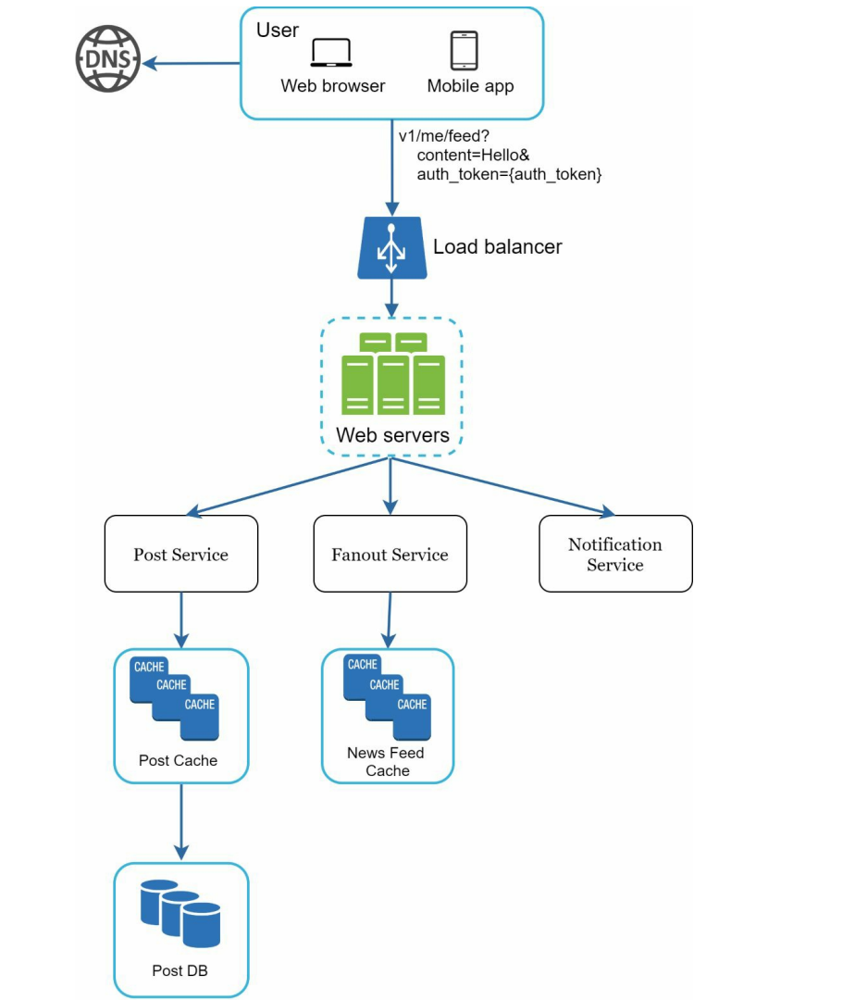
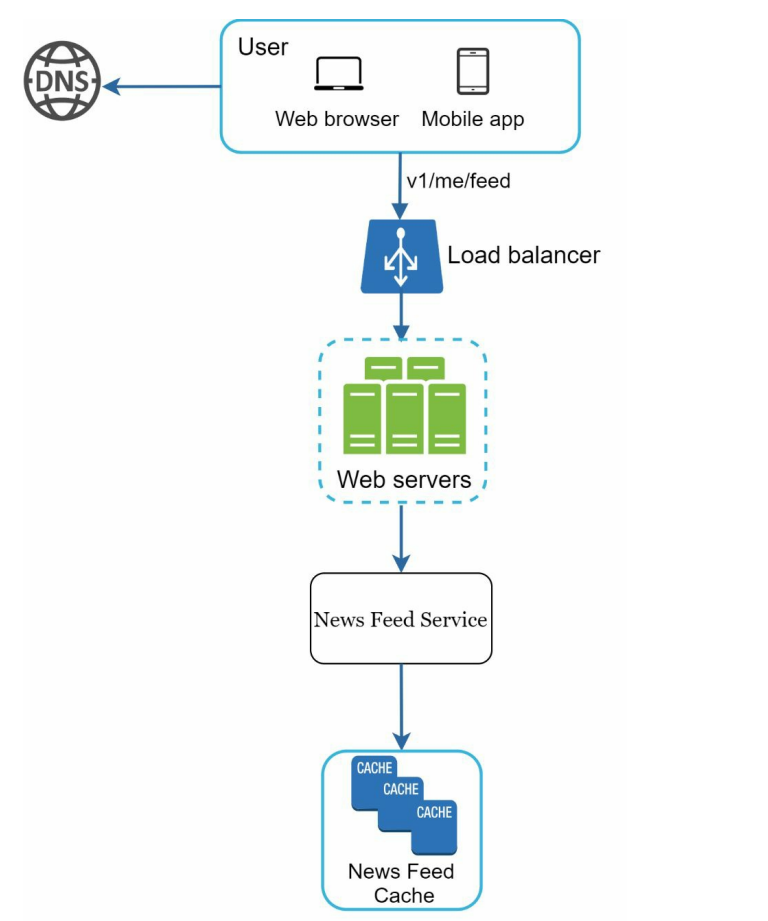
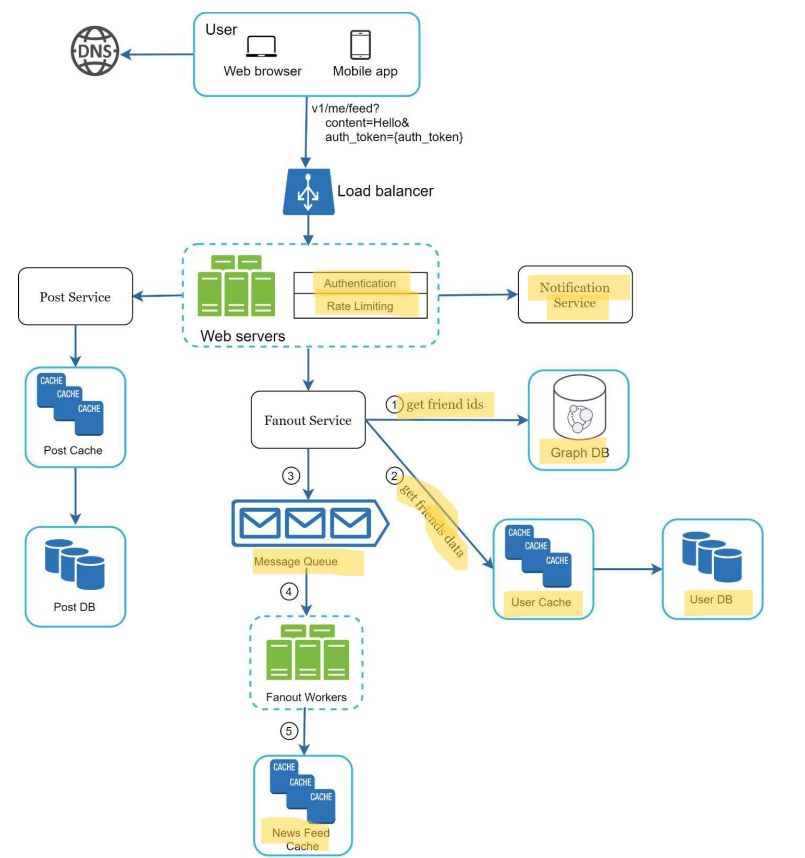
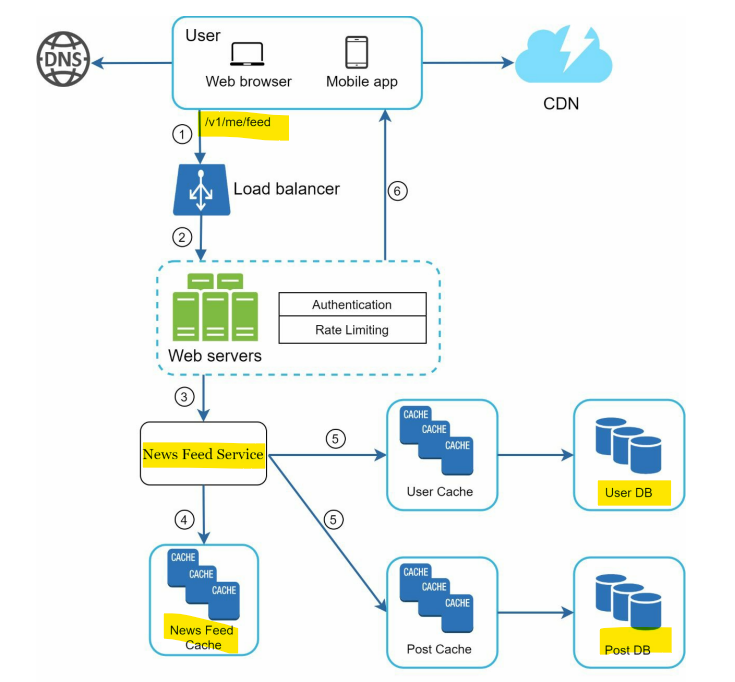

# System Design - Interview

[Back](../system_design.md)

- [System Design - Interview](#system-design---interview)
  - [4-step process](#4-step-process)
    - [Step 1 - Understand the problem and establish design scope](#step-1---understand-the-problem-and-establish-design-scope)
    - [Step 2 - Propose high-level design and get buy-in](#step-2---propose-high-level-design-and-get-buy-in)
    - [Step 3 - Design deep dive](#step-3---design-deep-dive)
    - [Step 4 - Wrap up](#step-4---wrap-up)
  - [Dos and Don’ts.](#dos-and-donts)
  - [Time allocation](#time-allocation)

---

## 4-step process

- no one-size-fits-all solution

---

### Step 1 - Understand the problem and establish design scope

- Don't rush for the answer
- Ask questions to understand the exact requirements.
  - What specific **features** are we going to build?
  - How many **users** does the product have? What is the traffic volume? (daily active users (DAU))
  - How **fast** does the company anticipate to **scale up**? What are the anticipated scales in **3 months, 6 months, and a year**?
  - What is the company’s **technology stack**? What **existing services** you might leverage to simplify the design?
  - Is this a mobile app? Or a web app? Or both?

---

### Step 2 - Propose high-level design and get buy-in

- collaborate with the interviewer
  - 1. initial blueprint for the design
    - Ask for feedback
  - 2. Draw box diagrams with key components on the whiteboard or paper.
  - 3. Evaluate if the blueprint fits the scales constraints
- If possible, go through a few **concrete use cases.**

---

- example: new feeding system

- High-level design
  - Post
    

  - feed
    

---

### Step 3 - Design deep dive

- both already have:
  - **Agreed** on the overall **goals** and feature scope
  - Sketched out a **high-level blueprint** for the overall design
  - Obtained **feedback** from your interviewer on the high-level design
  - Had some initial ideas about areas to focus on in deep dive based on her feedback

---

- example:
  - investigate two of the most important use cases:
    1. Feed publishing
    2. News feed retrieva

1. Feed publishing

1. News feed retrieva

---

### Step 4 - Wrap up

In this final step, the interviewer might ask you a few **follow-up questions** or give you the freedom to discuss other additional points.

Here are a few directions to follow:

- identify the system bottlenecks and discuss potential improvements.
  - show your critical thinking and leave a good final impression
- recap of your design.
- Error cases (server failure, network loss, etc.)
- Operation issues are worth mentioning. How do you monitor metrics and error logs? How to roll out the system?
- How to handle the next scale curve is also an interesting topic. For example, if your current design supports 1 million users, what changes do you need to make to support 10 million users?
- Propose other refinements you need if you had more time.

---

## Dos and Don’ts.

Dos

- Always ask for **clarification**. Do not assume your assumption is correct.
- Understand the **requirements** of the problem.
- There is neither the right answer nor the best answer. A solution designed to solve the problems of a young startup is different from that of an established company with millions of users. Make sure you understand the requirements.
- Let the **interviewer know what you are thinking**. **Communicate** with your interview.
- Suggest **multiple approaches** if possible.
- Once you agree with your interviewer on the blueprint, go into details on each component. **Design the most critical components first**.
- Bounce ideas off the interviewer. A good interviewer works with you as a teammate.
- Never give up.

Don’ts

- Don't be **unprepared** for typical interview questions.
- Don’t jump into a solution **without clarifying the requirements and assumptions**.
- Don’t go into **too much detail** on a single component in the **beginning**. Give the highlevel design first then drills down.
- If you get stuck, **don't hesitate to ask for hints**.
- Again, communicate. Don't think in silence.
- Don’t think your interview is done once you give the design. You are not done until your interviewer says you are done. Ask for feedback early and often.

---

## Time allocation

45m~1h

- Step 1 Understand the problem and establish design scope: 3 - 10 minutes
- Step 2 Propose high-level design and get buy-in: 10 - 15 minutes
- Step 3 Design deep dive: 10 - 25 minutes
- Step 4 Wrap: 3 - 5 minutes
