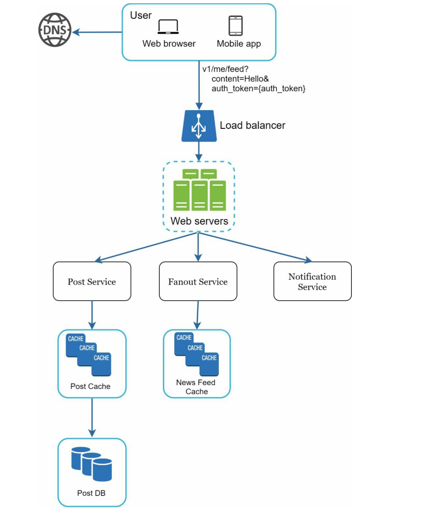
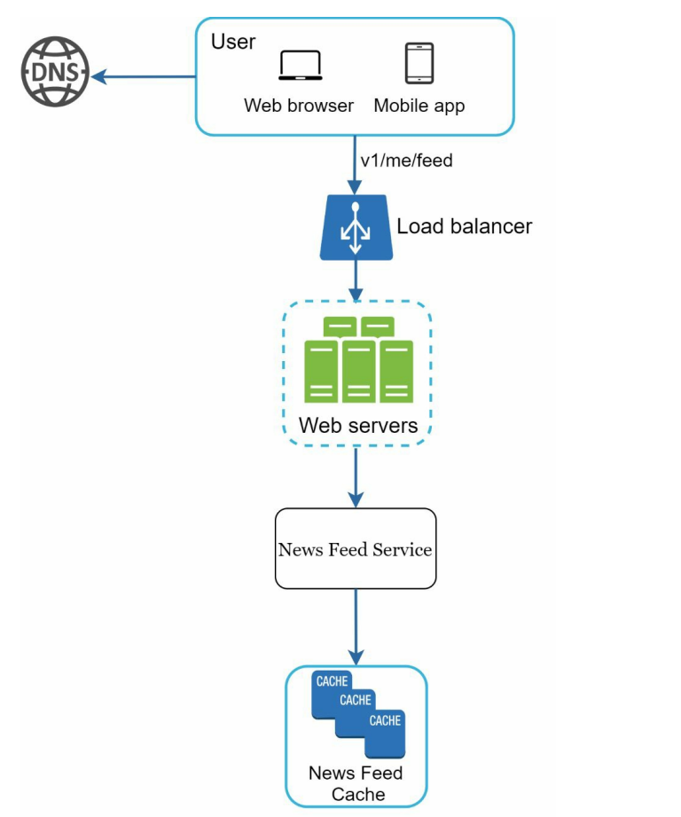

# System Design - Interview

[Back](../system_design.md)

- [System Design - Interview](#system-design---interview)
  - [Steps](#steps)
    - [Step 1: Requirements clarifications](#step-1-requirements-clarifications)
    - [Step 2: System interface definition](#step-2-system-interface-definition)
    - [Step 3: Defining data model](#step-3-defining-data-model)
    - [Step 4: High-level design](#step-4-high-level-design)
    - [Step 5: Detailed design](#step-5-detailed-design)
    - [Step 6: Wrap up](#step-6-wrap-up)
  - [Dos and Don’ts.](#dos-and-donts)
  - [Time allocation](#time-allocation)

---

## Steps

### Step 1: Requirements clarifications

- **functional** requirements
  - key features
  - UI: webapp + mobile

- **non-functional** requirements
  - Performance
  - Reliability & Availability
  - Security

- **estimation**
  - assumption:
    - Daily Active Users (DAU)
    - data/file size
  - traffic: read/write RPS
  - storage
  - bandwith
  - UUID

---

### Step 2: System interface definition

- UI: web + mobile
- Define what **APIs** are expected from the system **per feature**.
  - endpoints
  - header
  - param
  - return

---

### Step 3: Defining data model

- identify various **entities** of the system per **feature**
- **sql vs nosql**
- block **storage** for images and videos

---

### Step 4: High-level design

- Draw a block diagram with boxes representing the **core components** of our system.
  - client -> app server -> database

---

- example: new feeding system

- High-level design
  - Post
    

  - feed
    

---

### Step 5: Detailed design

- Get interviewer feedback and pick **one or two system-specific challenges**.
- For each, trace **requirement → bottleneck or failure → choice and trade-off → verification**.
- **Performance.**
  - Use peak load and the latency target to decide:
    - index,
    - cache,
    - or CDN
- **Reliability and availability.**
  - Consider overload (scaling, queues),
  - Failover (load balancers, replicas)
  - and recovery (RTO/RPO, 3-2-1 backups).
- **Security.**
  - Cover authentication
  - authorization
  - and the most likely abuse.

[Worked example: News Feed](../feed/feed.md#step-3---design-deep-dive)

---

### Step 6: Wrap up

- verify
  - Resolved
  - Open-ended
  - roadmap

---

## Dos and Don’ts.

Dos

- Always ask for **clarification**. Do not assume your assumption is correct.
- Understand the **requirements** of the problem.
- There is neither the right answer nor the best answer.
  - A solution designed to solve the problems of a young startup is different from that of an established company with millions of users. Make sure you understand the requirements.
- Let the **interviewer know what you are thinking**. **Communicate** with your interview.
- Suggest **multiple approaches** if possible.
- Once you agree with your interviewer on the blueprint, go into details on each component. **Design the most critical components first**.
- Bounce ideas off the interviewer. A good interviewer works with you as a teammate.
- Never give up.

Don’ts

- Don't be **unprepared** for typical interview questions.
- Don’t jump into a solution **without clarifying the requirements and assumptions**.
- Don’t go into **too much detail** on a single component in the **beginning**. Give the highlevel design first then drills down.
- If you get stuck, **don't hesitate to ask for hints**.
- Again, communicate. Don't think in silence.
- Don’t think your interview is done once you give the design. You are not done until your interviewer says you are done. Ask for feedback early and often.

---

## Time allocation

45m~1h

- Step 1 Understand the problem and establish design scope: 3 - 10 minutes
- Step 2 Propose high-level design and get buy-in: 10 - 15 minutes
- Step 3 Design deep dive: 10 - 25 minutes
- Step 4 Wrap: 3 - 5 minutes

---
