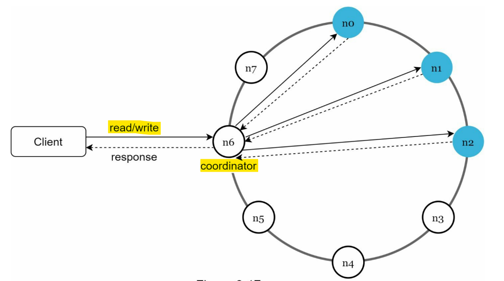
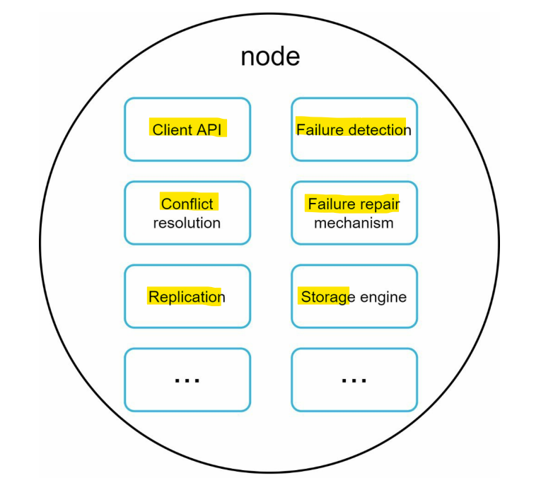
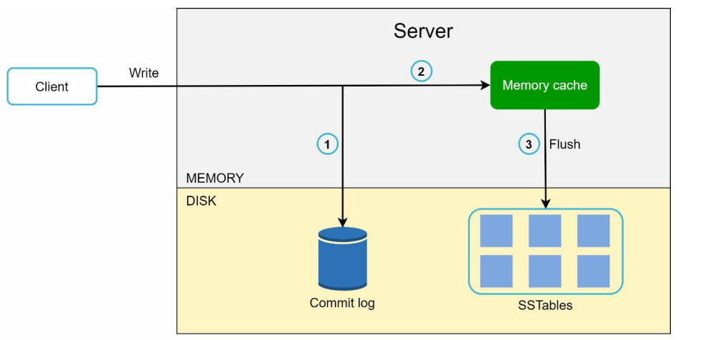
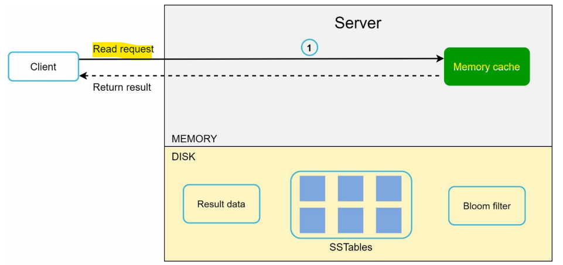
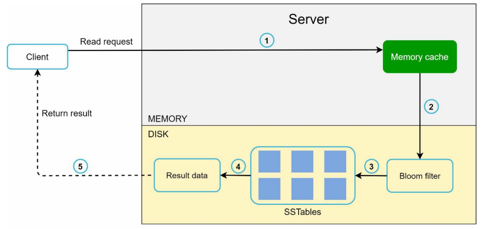

# System Design - KV store

[Back](../system_design.md)

- [System Design - KV store](#system-design---kv-store)
  - [KV store](#kv-store)
  - [Understand the problem and establish design scope](#understand-the-problem-and-establish-design-scope)
    - [Single server key-value store](#single-server-key-value-store)
    - [Distributed key-value store](#distributed-key-value-store)
      - [Data partition](#data-partition)
      - [Data replication](#data-replication)
      - [Consistency](#consistency)
      - [Inconsistency resolution: versioning](#inconsistency-resolution-versioning)
    - [Handling failures](#handling-failures)
      - [Failure detection](#failure-detection)
    - [System architecture diagram](#system-architecture-diagram)
  - [Summary](#summary)

---

## KV store

asked to design a key-value store that supports the following
operations:

- put(key, value) // insert “value” associated with “key”
- get(key) // get “value” associated with “key”

---

## Understand the problem and establish design scope

- requirements
  - The size of a key-value pair is small: less than 10 KB.
  - Ability to store big data.
  - High availability: The system responds quickly, even during failures.
  - High scalability: The system can be scaled to support large data set.
  - Automatic scaling: The addition/deletion of servers should be automatic based on traffic.
  - Tunable consistency.
  - Low latency.

---

### Single server key-value store

- use a hash table
- keeps everything in memory
- improve:
  - Data compression
  - Store only frequently used data in memory and the rest on disk
- limits:
  - space constraint.

---

### Distributed key-value store

#### Data partition

- split the data into smaller partitions and store them in multiple servers.
- challenges
  - Distribute data across multiple servers evenly.
  - Minimize data movement when nodes are added or removed.
- Solved by: Consistent hashing
  - servers could be added and removed automatically depending on the load.
  - Heterogeneity: servers with higher capacity are assigned with more virtual nodes.

#### Data replication

- To achieve high availability and reliability, data must be replicated asynchronously over N servers
  - choose the **first N servers** on the ring to store data copies
- For better reliability, replicas are placed in **distinct data centers**, and data centers are connected through high-speed networks.

#### Consistency

- Since data is replicated at **multiple nodes**, it must be **synchronized** across replicas.
- `Quorum consensus` can guarantee consistency for both read and write operations.

- Consistency model:
  - eventual consistency

---

#### Inconsistency resolution: versioning

- to solve inconistency caused by eventual consistency model
  - Versioning and vector locks

- Versioning:
  - treating each data **modification** as a **new immutable version** of data.
- vector clock
  - technique to solve and conflicts across replicas
  - a `[server, version]` pair associated with a data item.
  - can be used to check if one version precedes, succeeds, or in conflict with others

---

### Handling failures

#### Failure detection

- how to detet a server is down
  - all-to-all multicasting is a straightforward solution.
    - inefficient when many servers are in the system.
  - gossip protocol

- Handling temporary failures
  - `sloppy quorum` technique used to improve availability
    - chooses the first W healthy servers for writes
    - first R healthy servers for reads on the hash ring
    - Offline servers are ignored.

  - `hinted handoff`
    - If a server is unavailable due to network or server failures, **another server** will process requests **temporarily**.
    - When the down server is up, changes will be **pushed back** to **achieve data consistency**.

- Handling permanent failures: when a replica is permanently unavailable
  - anti-entropy protocol,
    - a hash tree is used for **inconsistency detection** and **minimizing the amount of data transferred**.

- Handling data center outage
  - replicate data across multiple data centers.

---

### System architecture diagram

- Main features of the architecture are listed as follows:
  - Clients communicate with the key-value store through simple APIs: `get(key)` and `put(key, value)`.
  - A **coordinator** is a node that acts as a **proxy** between the client and the key-value store.
  - Nodes are distributed on a ring using **consistent hashing**.
    - The system is **completely decentralized** so adding and moving nodes can be automatic.
  - Data is **replicated** at **multiple nodes**.
    - There is **no single point of failure** as every node has the same set of responsibilities.

- each node performs many tasks:

- Write path
  

- 1. The write request is persisted on a `commit log file`.
- 2. Data is saved in the `memory cache`.
- 3. When the `memory cache` is full or reaches a predefined threshold, data is flushed to SSTable on disk.

- Read path
  
  - If the data is not in memory
    

---

## Summary

| Goal/Problems               | Technique                                                    |
| --------------------------- | ------------------------------------------------------------ |
| Ability to store big data   | Use consistent hashing to **spread the load across servers** |
| High **availability** reads     | Data **replication**; Multi-data center setup                    |
| Highly available writes     | **Versioning** and **conflict** resolution with vector clocks        |
| Dataset **partition**           | Consistent Hashing                                           |
| Incremental scalability     | Consistent Hashing                                           |
| Heterogeneity               | Consistent Hashing                                           |
| Tunable consistency         | Quorum consensus                                             |
| Handling temporary failures | Sloppy quorum and hinted handoff                             |
| Handling permanent failures | Merkle tree                                                  |
| Handling data center outage | Cross-data center replication                                |
