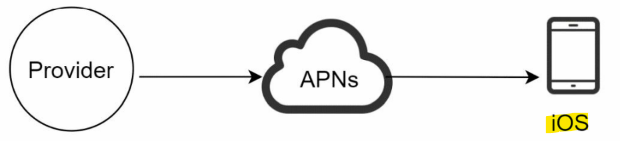
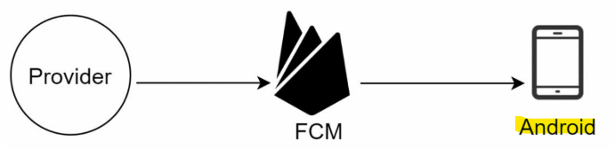
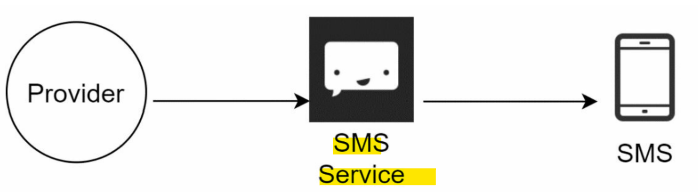
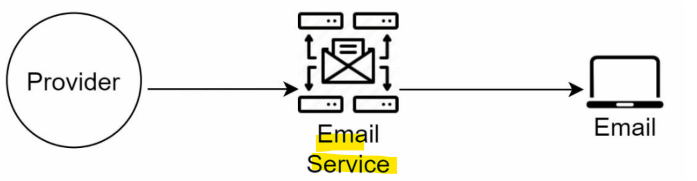
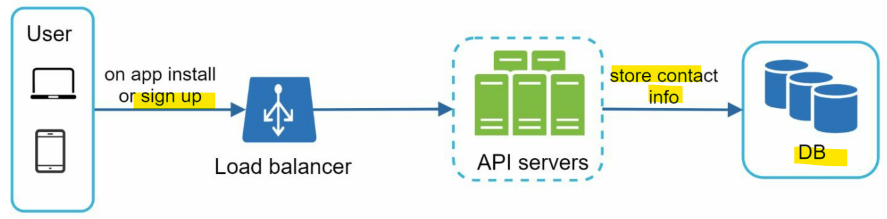
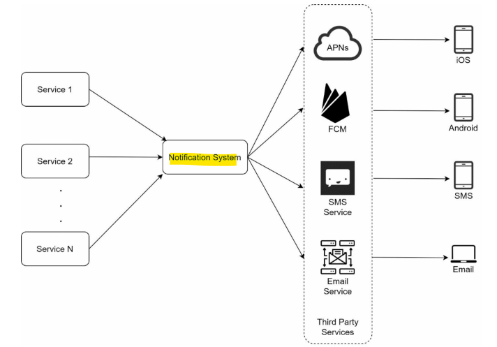
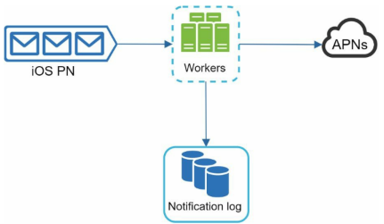
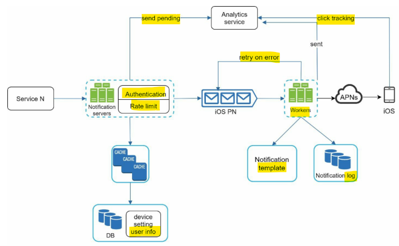

# System Design - Notification System

[Back](../system_design.md)

- [System Design - Notification System](#system-design---notification-system)
  - [Notification System](#notification-system)
  - [Step 1 - Understand the problem and establish design scopes](#step-1---understand-the-problem-and-establish-design-scopes)
  - [Step 2 - Propose high-level design and get buy-in](#step-2---propose-high-level-design-and-get-buy-in)
    - [Different types of notifications](#different-types-of-notifications)
    - [Contact info gathering flow](#contact-info-gathering-flow)
    - [Notification sending/receiving flow](#notification-sendingreceiving-flow)
  - [Step 3 - Design deep dive](#step-3---design-deep-dive)
    - [Reliability](#reliability)
    - [Additional components and considerations](#additional-components-and-considerations)
  - [Step 4 - Wrap up](#step-4---wrap-up)

---

## Notification System

- 3 types of notification formats are:
  - mobile push notification,
  - SMS message,
  - Email.

---

## Step 1 - Understand the problem and establish design scopes

- Q:
  - What types of notifications does the system support?
  - Is it a real-time system?
  - What are the supported devices?
  - What triggers notifications?
  - Will users be able to opt-out?
  - How many notifications are sent out each day?

- R:
  - 10 million mobile push notifications, 1 million SMS messages, and 5 million emails.

---

## Step 2 - Propose high-level design and get buy-in

### Different types of notifications

- iOS push notification
  

  > Apple Push Notification service (APNs)

- Android push notification
  

  > Firebase Cloud Messaging (FCM)

- SMS message
  

- Email
  

---

### Contact info gathering flow

---

### Notification sending/receiving flow

- **Service 1 to N**: A service can be a micro-service, a cron job, or a distributed system that triggers notification sending events.
- **Notification system**
- **Third-party services**: Third party services are responsible for delivering notifications to users.

1. A **service calls APIs** provided by notification servers to send notifications.
2. Notification servers **fetch metadata** such as user info, device token, and notification setting from the cache or database.
3. A notification event is sent to the **corresponding queue** for processing.
   - For instance, an iOS push notification event is sent to the iOS PN queue.
4. Workers pull notification events from **message queues**.
5. Workers **send** notifications to third party services.
6. Third-party services send notifications to user devices.

---

## Step 3 - Design deep dive

### Reliability

- How to prevent data loss?
  - To satisfy this requirement, the notification system persists notification data in a database and implements a **retry mechanism**.
  - solution: notification log database
    

- Will recipients receive a notification exactly once?
  - To reduce the duplication occurrence, we introduce a **dedupe mechanism** and handle each failure case carefully.
  - When a notification event first arrives, we check if it is seen before by **checking the event ID**.
    - If it is seen before, it is discarded.
    - Otherwise, we will send out the notification.

### Additional components and considerations

- Notification template
  - consistent format, reducing the margin error, and saving time.
- Notification setting
  - Before any notification is sent to a user, we first check if a user is opted-in to receive this type of notification.
- Rate limiting
  - limit the number of notifications a user can receive.
- Retry mechanism
- Security in push notifications
- Monitor queued notifications
- Events tracking

---

---

## Step 4 - Wrap up

