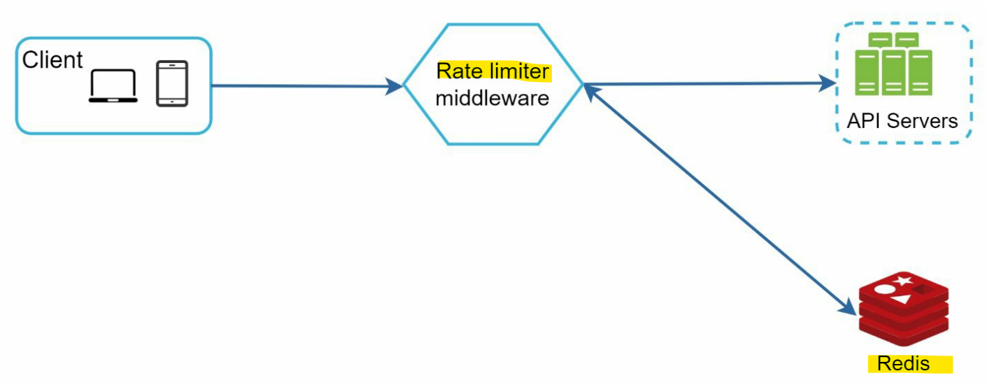
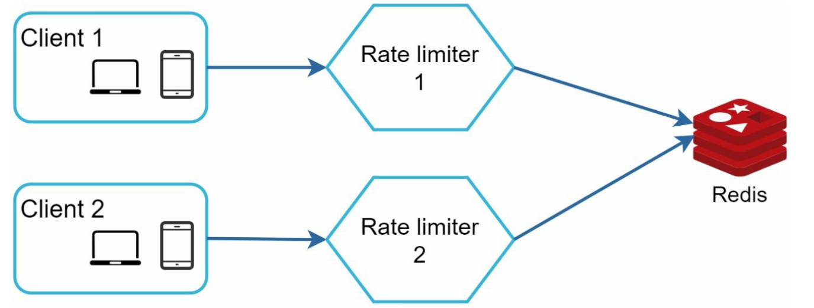

# System Design - Rate limiter

[Back](../system_design.md)

- [System Design - Rate limiter](#system-design---rate-limiter)
  - [Rate limiter](#rate-limiter)
  - [Step 1 - Understand the problem and establish design scope](#step-1---understand-the-problem-and-establish-design-scope)
  - [Step 2 - Propose high-level design and get buy-in](#step-2---propose-high-level-design-and-get-buy-in)
    - [Token bucket algorithm](#token-bucket-algorithm)
    - [Leaking bucket algorithm](#leaking-bucket-algorithm)
    - [Fixed window counter algorithm](#fixed-window-counter-algorithm)
    - [Sliding window log algorithm](#sliding-window-log-algorithm)
    - [Sliding window counter algorithm](#sliding-window-counter-algorithm)
    - [High-level architecture](#high-level-architecture)
  - [Step 3 - Design deep dive](#step-3---design-deep-dive)
    - [distributed environment challenges](#distributed-environment-challenges)
    - [Performance optimization](#performance-optimization)
    - [Monitoring](#monitoring)
  - [Step 4 - Wrap up](#step-4---wrap-up)

---

## Rate limiter

- `rate limiter`
  - limits the number of client requests allowed to be sent over a specified period
  - If the API request count **exceeds the threshold** defined by the rate limiter, all the excess calls are s.

- benefits
  - Prevent servers from being overloaded.
  - Prevent resource starvation caused by Denial of Service (DoS) attack.
  - Reduce cost.
    - Limiting excess requests means **fewer servers**

---

## Step 1 - Understand the problem and establish design scope

- What kind of rate limiter are we going to design?
- Is it a client-side rate limiter or server-side API rate limiter?
- Does the rate limiter **throttle** API requests based on IP, the user ID, or other properties?
- What is the **scale** of the system? Is it built for a startup or a big company with a large user base?
- Will the system work in a distributed environment?
- Is the rate limiter a **separate service** or should it be implemented in **application code**?
- Do we need to **inform users** who are throttled?

---

- Requirements
  - Accurately **limit excessive requests**.
  - Low **latency**. The rate limiter should not slow down HTTP response time.
  - Use as **little memory** as possible.
  - **Distributed** rate limiting. The rate limiter can be **shared** across multiple servers or processes.
  - **Exception** handling. Show clear exceptions to users when their requests are throttled.
  - High **fault tolerance**. If there are any problems with the rate limiter (for example, a cache server goes offline), it does not affect the entire system.

---

## Step 2 - Propose high-level design and get buy-in

- Where to implement rate limiter
  - a basic client and server model
    - Client-side implementation.
      - easily be forged by malicious actors
      - not have control
    - Server-side implementation.
  - alternative way:
    - rate limiter middleware
    - e.g., Cloud microservices like API gateway
- consideration:
  - technology stack
  - rate limiting algorithm: fits business needs
  - engineering resources: time,personel

- Common Algorithms
  - Token bucket
  - Leaking bucket
  - Fixed window counter
  - Sliding window log
  - Sliding window counter

### Token bucket algorithm

- widely used

- algorithm
  - Tokens are put in the bucket at preset rates periodically.
    - Once the bucket is full, no more tokens are added.
  - Each request consumes one token.
    - When a request arrives, we check if there are enough tokens in the bucket
      - If there are enough tokens, the request goes through
      - If there are not enough tokens, the request is dropped.
- two parameters
  - Bucket size: the maximum number of tokens allowed in the bucket
  - Refill rate: number of tokens put into the bucket every second

---

### Leaking bucket algorithm

- implemented with a first-in-first-out (FIFO) queue.
- algorithm
  - When a request arrives, the system **checks** if the queue is full.
    - If it is not full, the request is added to the queue.
    - Otherwise, the request is dropped.
  - Requests are **pulled** from the queue and processed at regular intervals.

- parameters
  - Bucket size
  - Outflow rate

---

### Fixed window counter algorithm

- algorithm
  - divides the timeline into **fix-sized time windows** and assign a **counter** for each window.
  - Each request **increments the counter** by one.
  - Once the counter reaches the pre-defined **threshold**, new requests are **dropped** until a new time window starts.

---

### Sliding window log algorithm

- algorithm
  - keeps **track of request timestamps**. Timestamp data is usually kept in cache, such as sorted sets of Redis.
  - When a new request comes in, remove all the outdated timestamps.
    - Outdated timestamps are defined as those older than the start of the current time window.
    - Add timestamp of the new request to the log.
  - If the log size is the same or **lower** than the allowed count, a request is **accepted**.
    - Otherwise, it is **rejected**.

---

### Sliding window counter algorithm

skip

---

### High-level architecture

- In-memory cache is chosen because it is fast and supports time-based expiration strategy.
  - Redis
    - INCR: stored counter by 1.
    - EXPIRE: sets a timeout for the counter.

---

## Step 3 - Design deep dive

- following questions:
- How are rate limiting rules created? Where are the rules stored?
  - like yaml file; store on disk.
- How to handle requests that are rate limited?
  - based on the use case
    - HTTP response code 429 (too many requests)
    - enqueue the rate-limited requests to be processed later.
- How does a client know whether it is being throttled? And how does a client know the number of allowed remaining requests before being throttled?
  - HTTP response headers. eg:
    - X-Ratelimit-Remaining
    - X-Ratelimit-Limit
    - X-Ratelimit-Retry-After

---

### distributed environment challenges

- Race condition issue
  - Locks are the most obvious solution for solving race condition.
  - will significantly slow down the system
    - solved by:
      - Lua script and sorted sets data structure in Redis

- Synchronization issue
  - When multiple rate limiter servers are used, synchronization is required.
  - solution is to use `sticky sessions`: allow a client to send traffic to the same rate limiter.
    - not advisable because it is neither scalable nor flexible
  - better approach is to use centralized data stores like Redis.

---

### Performance optimization

- lateny: solved by multi-data center setup closed to users
- synchronize data with an `eventual consistency model`.

---

### Monitoring

- gather data to check
  - The rate limiting algorithm is effective.
  - The rate limiting rules are effective.

---

## Step 4 - Wrap up

- additional talking points
  - Hard vs soft rate limiting.
    - Soft: Requests can exceed the threshold for a short period.
  - Rate limiting at different levels.
    - for IP addresses using Iptables (IP: layer 3)
  - Avoid being rate limited
    - Use client cache to avoid making frequent API calls.
    - Understand the limit and do not send too many requests in a short time frame.
    - Include code to catch exceptions or errors so your client can gracefully recover from exceptions.
    - Add sufficient back off time to retry logic.
