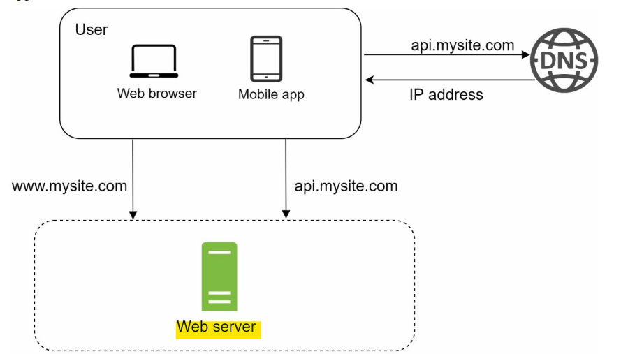
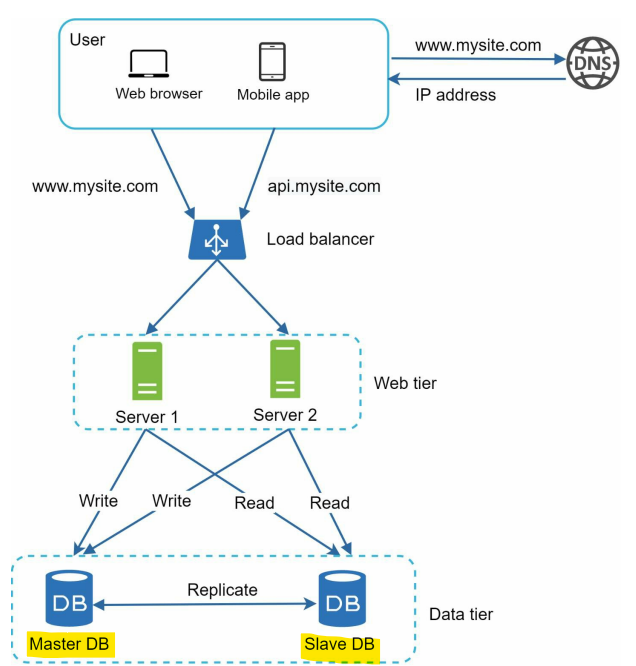
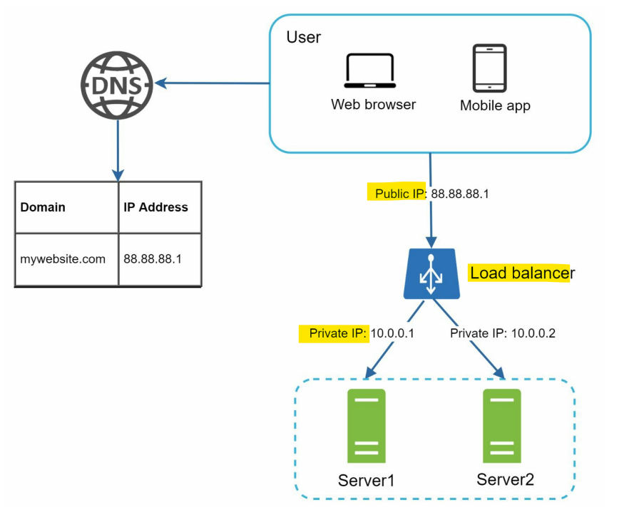
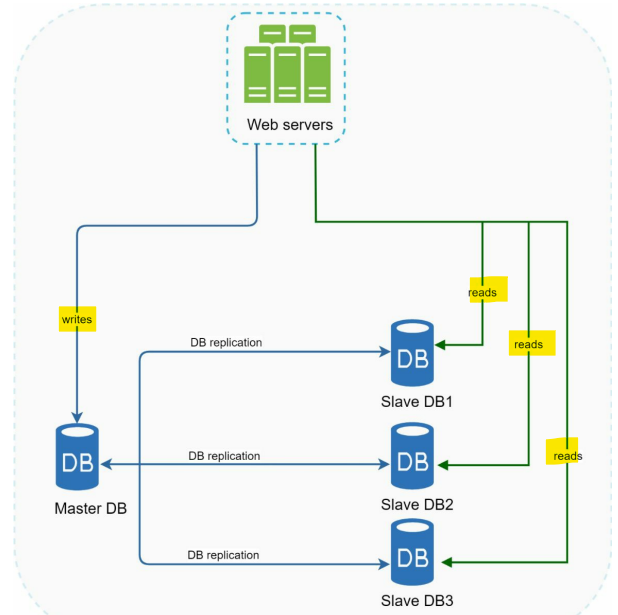
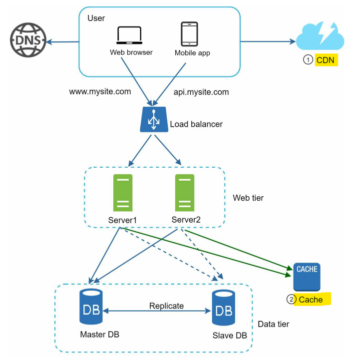
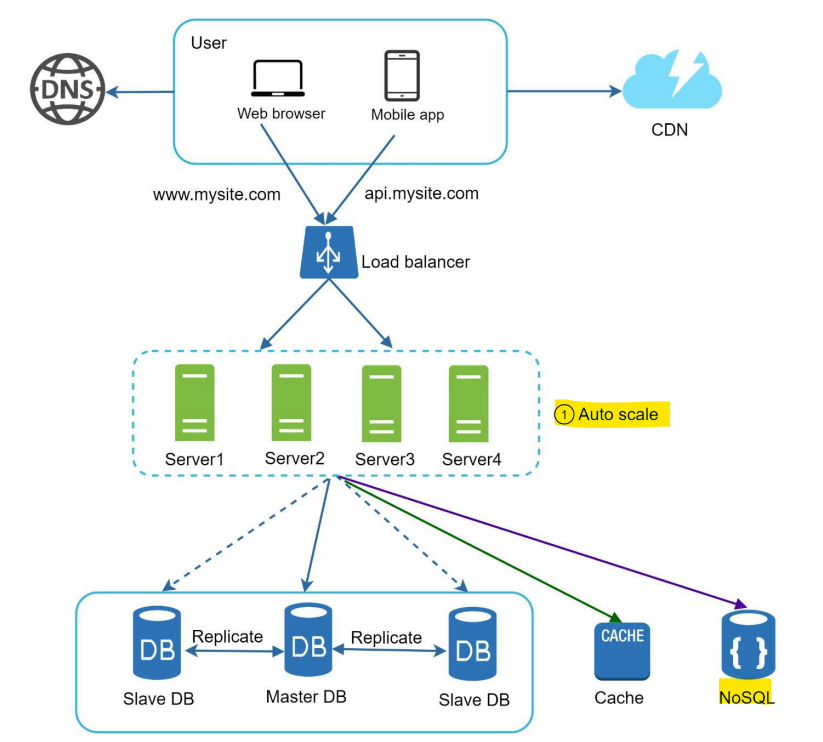
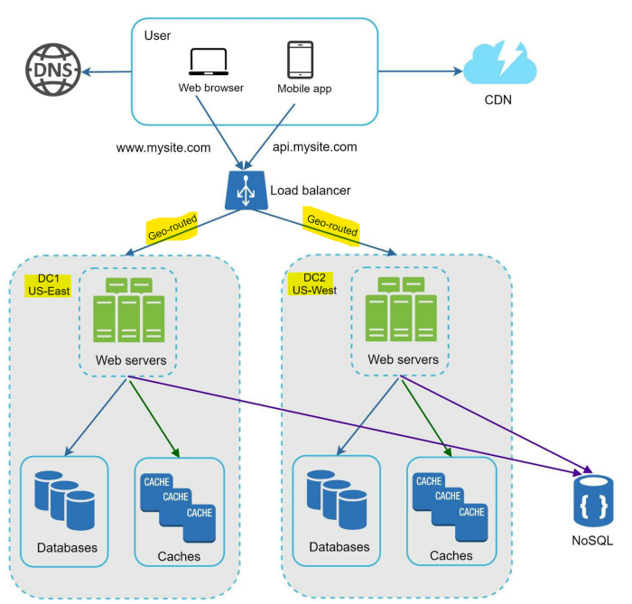
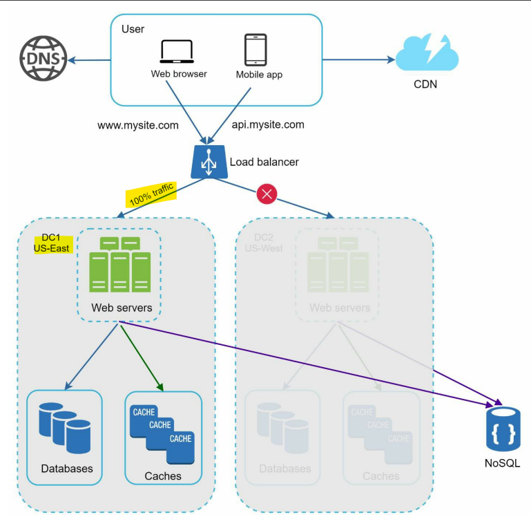
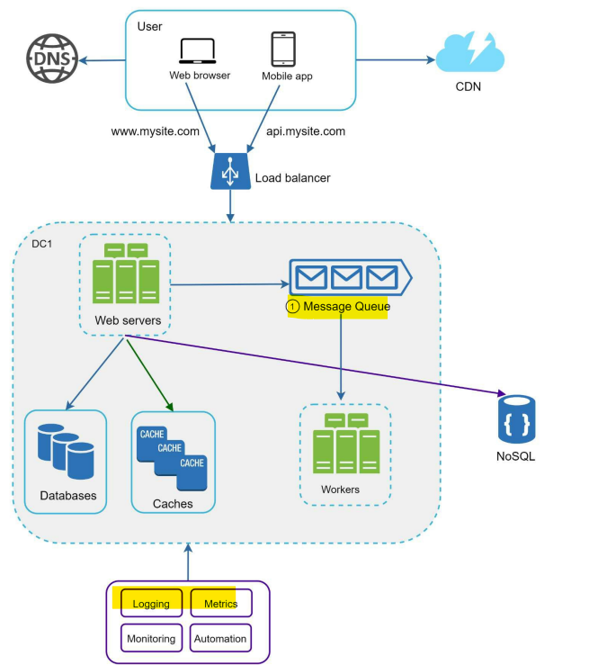
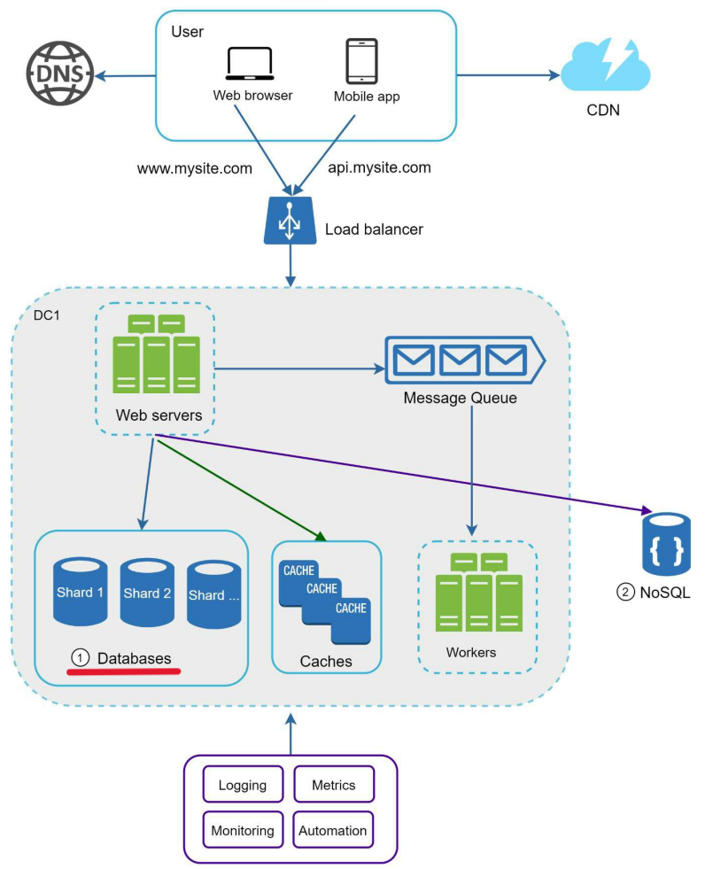

# System Design - SCALE FROM ZERO TO MILLIONS OF USERS

[Back](../system_design.md)

- [System Design - SCALE FROM ZERO TO MILLIONS OF USERS](#system-design---scale-from-zero-to-millions-of-users)
  - [SCALE FROM ZERO TO MILLIONS OF USERS](#scale-from-zero-to-millions-of-users)
    - [Single server setup](#single-server-setup)
    - [Database](#database)
    - [horizontal scaling \& load balancer](#horizontal-scaling--load-balancer)
    - [Database replication](#database-replication)
    - [cache](#cache)
    - [Content delivery network (CDN)](#content-delivery-network-cdn)
    - [Stateless vs statefule](#stateless-vs-statefule)
    - [Autoscaling](#autoscaling)
    - [Data centers(multi-region)](#data-centersmulti-region)
    - [Message queue](#message-queue)
    - [Database sharding](#database-sharding)

---

## SCALE FROM ZERO TO MILLIONS OF USERS

- a **single user** and gradually scale it up to serve **millions of users**

### Single server setup

---

### Database

---

### horizontal scaling & load balancer

- failover
- availability

### Database replication

- architecture:
  - master: write operation
  - slave: sync with master; read opearation;
  - different locations
- benefits:
  - Better performance
  - Reliability: data is replicated across multiple locations.
  - High availability
    - if master offline, relica beome master

### cache

- **cache tier:** a temporary data store layer
  - check if cache available
    - yes, return from cache
    - no, return from db
- **Considerations**
  - used when data is read frequently but modified infrequently
  - Expiration policy:
    - not too short, hit db
    - not too long, data stale
  - **Consistency**
  - **single point of failure (SPOF)**: **multiple** cache servers across different data centers are recommended to avoid `SPOF`
  - **Cache eviction**:
    - **removing** data from a limited computer cache when it reaches its maximum capacity
    - eviction policy:
      - Least-recently-used (LRU)
      - Least-Frequently Used (LFU)
      - First in First Out (FIFO)

### Content delivery network (CDN)

- cache static content
- considerations:
  - cache expiry time

### Stateless vs statefule

- stateless
  - servers do **not retain** any user **session data** or **context** between requests
- statefule
  - a server that **saves** and remembers client **session data**, **context**, and **transaction history** from one request to the next.
- `sticky sessions` in load balancers
  - a configuration technique where a load balancer routes all sequential requests from **a specific user** to the **exact same backend server** for the entire duration of their session
  - challenge: make scale out or in difficult
- Stateless architecture
  - HTTP requests from users can be sent to **any** web servers
  - web servers fetch state data from a **shared data store**

---

### Autoscaling

- adding or removing web servers **automatically** based on the **traffic load**.

> nosql is used as shared data store for stateless servers

---

### Data centers(multi-region)

- `geo-routed`: route users to the closest data center

- event of any significant data center outage

---

### Message queue

- `message queue`
  - a software component that allows different parts of a system to **communicate asynchronously** by temporarily storing data packets (messages) in a **buffer** until a receiving application is ready to process them.
    - `producers/publishers`: creates and sends the message
    - `Message Queue / Broker`: holds messages in order and manages delivery.
    - `consumers/subscribers`: retrieves the message and execute

---

- Logging, metrics, automation

---

### Database sharding

- `Horizontal scaling/sharding`
  - a horizontal scaling technique that **splits a large database** into **smaller**, independent pieces called `shards` and distributes them across multiple physical or logical machines (nodes).
    - Each `shard` shares the **same schema**
    - the **actual data** on each shard is **unique** to the `shard`.

- `Sharding key`/`partition key`
  - consists of one or more **columns** that determine how data is distributed.

