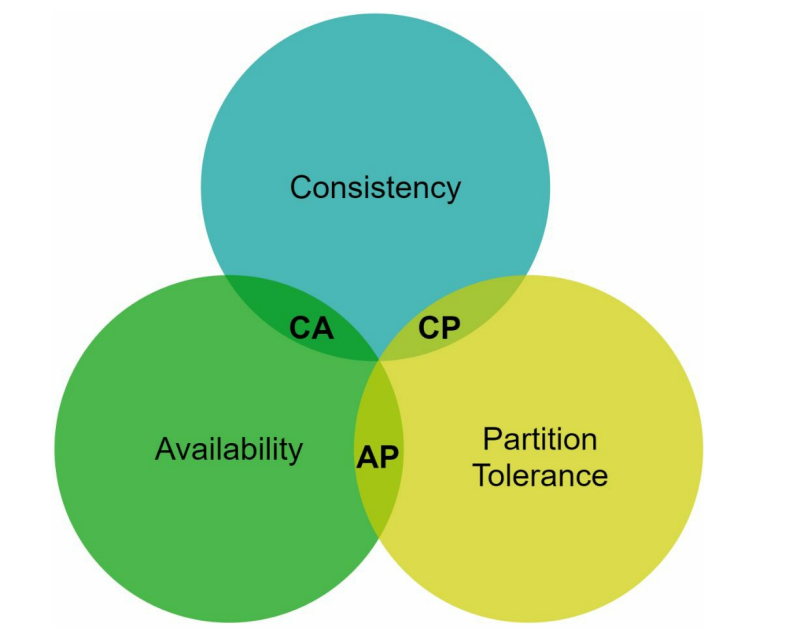
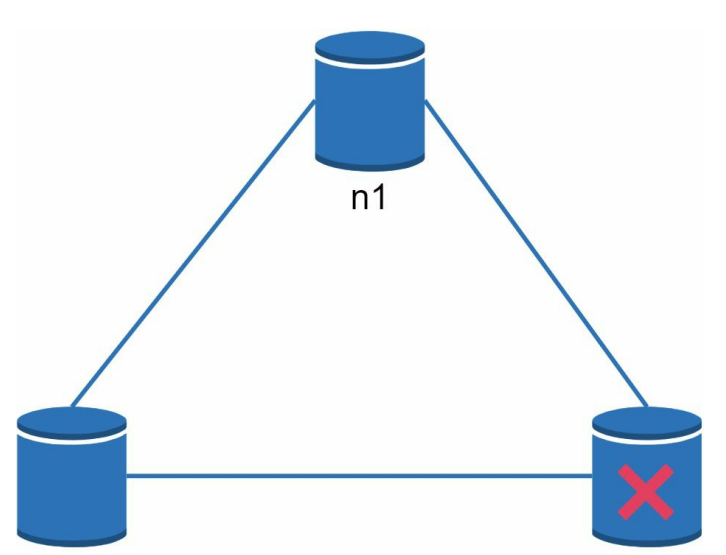
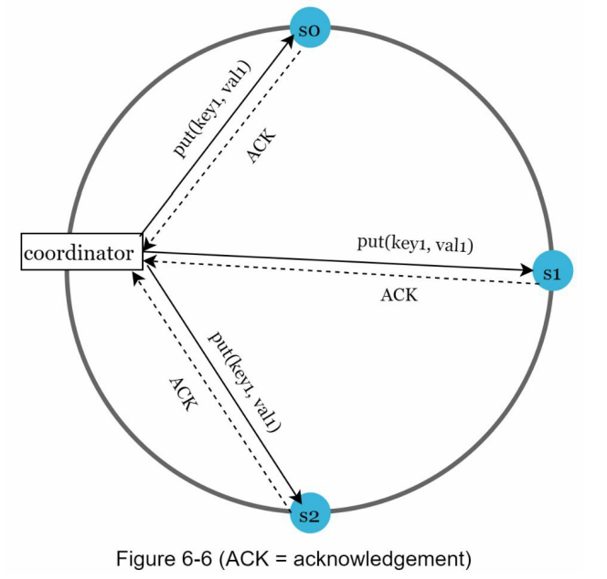

- system design interview

- [SCALE FROM ZERO TO MILLIONS OF USERS](./scale/scale.md)

- [BACK-OF-THE-ENVELOPE ESTIMATION](./estimate/estimate.md)
- [Interview](./interview/interview.md)
- [Design rate limiter](./rate_limiter/rate_limiter.md)
- [Design consistent hashing](./hashing/hashing.md)
- [Design key-value store](./kv/kv.md)

---
 
## CAP Theorem

- `CAP (Consistency, Availability, Partition Tolerance) theorem`
  - it is **impossible** for a distributed system to simultaneously provide **more than two** of these three guarantees: `consistency`, `availability`, and `partition tolerance`.

- `Consistency`:
  - **all** clients see the **same data** at the **same time** no matter which node they connect to

- `Availability`:
  - **any** client which requests data **gets a response** even if some of the nodes are **down**.

- `Partition Tolerance`:
  - a `partition` indicates a communication break between two nodes.
  - the system **continues** to operate despite **network partitions**.

---

- `CP (consistency and partition tolerance) systems`:
  - a distributed system supports `consistency` and `partition tolerance` while sacrificing `availability`.

- `AP (availability and partition tolerance) systems`:
  - a distributed system supports `availability` and `partition tolerance` while sacrificing `consistency`.

- `CA (consistency and availability) systems`:
  - a distributed system supports `consistency` and `availability` while sacrificing `partition tolerance`.
  - Since network failure is **unavoidable**, a distributed system **must tolerate** `network partition`.
    - Thus, a CA system **cannot exist** in realworld applications.

---

- Data written to `n1`
  - automatically replicated to `n2` and `n3`
- when a partition occurs, `n3` goes down
  - CP system:
    - must **block all write** operations to `n1` and `n2` to **avoid data inconsistency** among these three servers
    - example: Bank systems
  - AP system:
    - keeps accepting reads, even though it might return **stale data**
    - keeps accepting writes, and data will be **synced** to n3 when the network partition is resolved.

---

## Quorum consensus

- `Quorum consensus`
  - a technique used in distributed systems to **maintain data consistency, availability, and fault tolerance** without requiring every single node to respond.
  - relies on a minimum number of participating nodes (a quorum) to agree on read and write operations.

- Definitions:
  - N = The number of **replicas**
  - W = A **write quorum** of size W.
    - For a **write operation** to be considered as successful, write operation must be acknowledged from W replicas.
  - R = A **read quorum** of size R.
    - For a **read operation** to be considered as successful, read operation must wait for responses from at least R replicas.

- **configuration of W, R and N is a typical tradeoff between latency and consistency.**
  - `W = 1` or `R = 1`,
    - an operation is **returned quickly** because a coordinator only needs to wait for a response from any of the replicas.
  - If `W` or `R > 1`,
    - the system offers better **consistency**; however, the query will be **slower** because the coordinator must wait for the response from the **slowest replica**.

  - If `W + R > N`,
    - **strong consistency** is guaranteed because there must be **at least one overlapping** node that has the latest data to ensure consistency.

- How to configure N, W, and R to fit our use cases? Here are some of the possible setups:
  - If `R = 1` and `W = N`, the system is optimized for a **fast read**.
  - If `W = 1` and `R = N`, the system is optimized for **fast write**.
  - If `W + R > N`, **strong consistency** is guaranteed (Usually N = 3, W = R = 2).
  - If `W + R <= N`, strong consistency is **not guaranteed**.

---

- example

- A coordinator acts as a proxy between the client and the nodes.
- N = 3
  - data is replicated at s0, s1, and s2.
- W = 1
  - the coordinator must receive at least one acknowledgment before the write operation is considered as successful.
  - if we get an acknowledgment from s1, we no longer need to wait for acknowledgements from s0 and s2.

---

## Consistency models

- Consistency models
  - defines the degree of data consistency

- `Strong consistency`:
  - any **read operation** returns a value corresponding to the result of the **most updated write data item**.
  - A client never sees out-of-date data.
  - by forcing a replica **not to accept new** reads/writes **until** every replica has **agreed on current write**.
  - no highly available system
    - block new operations
- `Weak consistency`:
  - subsequent read operations may **not see the most updated value**.
- `Eventual consistency`:
  - this is a specific form of weak consistency.
  - Given enough **time**, all updates are propagated, and **all** replicas are **consistent**.
  - e.g., Dynamo and Cassandra
