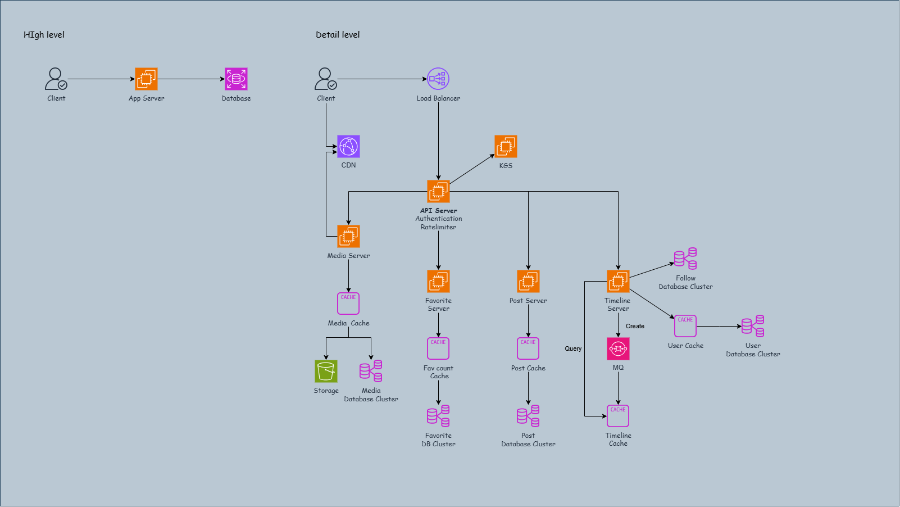

# System Design - Product: Twitter

[Back](../system_design.md)

- [System Design - Product: Twitter](#system-design---product-twitter)
  - [Twitter](#twitter)
  - [Step 1 - Requirements](#step-1---requirements)
    - [Estimation](#estimation)
  - [Step 2 - API design](#step-2---api-design)
  - [Step 3 - Data model](#step-3---data-model)
  - [Step 4 - High level](#step-4---high-level)
  - [Step 5 - Detail Design](#step-5---detail-design)
    - [Reliability \& HA](#reliability--ha)
    - [Performance](#performance)
    - [Security](#security)
    - [Specific issues](#specific-issues)
    - [Flowchart](#flowchart)
    - [Diagram](#diagram)
  - [Step 6 - Wrap up](#step-6---wrap-up)

---

## Twitter

## Step 1 - Requirements

**Functional Requirements**

1. Users should be able to **post** new tweets.
2. A user should be able to **follow** other users.
3. Users should be able to **mark** tweets as **favorites**.
4. The service should be able to **create and display** a user’s **timeline** consisting of **top tweets** from all the people the user follows.
5. Tweets can contain **photos and videos**.

**Non-functional Requirements**

1. Our service needs to be **highly available**.
2. Acceptable **latency** of the system is 200ms for timeline generation.
3. **Consistency** can take a hit (in the interest of availability); if a user doesn’t see a tweet for a while, it should be fine.

**Extended Requirements**

1. **Searching** for tweets.
2. **Replying** to a tweet.
3. **Trending topics** – current hot topics/searches.
4. **Tagging** other users.
5. Tweet **Notification**.
6. Who to follow? Suggestions?
7. Moments.

---

### Estimation

- **assume**
  - total users: 1B
  - DAU: 200M
  - new tweet per day: 100M
  - avg follows per user: 200
  - favorite tweets per day per user: 5
  - avg visit user timeline per user per day: 2
  - avg visit follow timeline per user per day: 5
  - avg tweets on per page per user: 20
  -
- **Perfomance**:
  - write: 100M / 3600s / 24h = 1160 rps
  - write peak: 1160 rps \* 2 = 2330 rps
  - read: 20 tweets/page \* (2 + 5 timeline/day) \* 200M / 3600s / 24h = 330k qps
  - read peak: 330k qps \* 2 = 660 qps
- **Storage:**
  - media: 100M DAU \* avg img size + 100M DAU \* avg video size
- **Bandwidth**:
  - 200M DAU \* avg media size

---

## Step 2 - API design

**Feature: post new tweet post**

- `POST /api/v1/post`
- header: api_token required
- param:
  - post_data
  - media_data

---

**Feature: get tweet post**

- `GET /api/v1/post/<post_id>`
- header: api_token optional
- param:
  - post_id
- return
  - post_data
  - media_url

- `GET /api/v1/media/<media_url>`
- header: api_token optional
- param:
  - media_url
- return
  - media_data

---

**Feature: get timeline**

- `GET /api/v1/tl/<user_id>`
- header: api_token optional
- param:
  - user_id
- return
  - list
    - post_id

---

**Feature: favorite a post**

- `POST /api/v1/fav`
- header: api_token required
- param:
  - post_id

---

## Step 3 - Data model

- **User table**

| field   | datatype | desc    |
| ------- | -------- | ------- |
| user_id | id       | user id |
| email   | varchar  | email   |

- SQL

- **post table**

| field      | datatype  | desc               |
| ---------- | --------- | ------------------ |
| post_id    | uudi      | post id            |
| post_data  | varchar   | post data          |
| created_at | timestamp | creation timestamp |
| media_id   | int       | media id           |

- SQL

- **media table**

| field         | datatype  | desc                  |
| ------------- | --------- | --------------------- |
| media_id      | uudi      | media id              |
| created_at    | timestamp | creation timestamp    |
| media_storage | varchar   | media storage arn/url |

- SQL

- **follow table**

| field          | datatype  | desc             |
| -------------- | --------- | ---------------- |
| user_id        | int       | user id          |
| follow_at      | timestamp | follow timestamp |
| follow_user_id | int       | follow user id   |

- NoSQL KV

- **favorite table**

| field   | datatype  | desc                   |
| ------- | --------- | ---------------------- |
| post_id | int       | post id                |
| user_id | int       | user id                |
| fav_at  | timestamp | tag favorite timestamp |

- NoSQL kv

---

## Step 4 - High level

```
client -> app server -> database
```

---

## Step 5 - Detail Design

### Reliability & HA

- Issue: API/App server == SPOF
  - Solution: **Load Balancer**
    - LB check server health status
    - distrubte traffic to server

- Issue: DB server == SPOF
  - Solution: **replica; master-standby**
    - **master-standby**: if master fails, standby becomes master
    - **primary-read**: if one read down, get from another read

- Issue: data loss of media
  - Solution: **Storage Replication**
    - replica storage

---

### Performance

- Issue: high rps
  - Solution: **Horizontal scaling; micro-services**
    - HS: handle more traffic
    - micro-services: separate user login, timeline, tweeter post, favorite

- Issue: medias files loading slow
  - Solution: **CDN**
    - cache static files
    - cache last 3 days medias

- Issue: upload = time-consuming
  - Solution: **upload and download servers**
    - Separate upload from download

- Issue: query db, e.g., user, hot post
  - Solution: **Cache(memory)**
    - cache hot data in memory, `redis`
    - eviction policy: `Least Recently Used (LRU)`
    - cache latest 3 days post data

---

### Security

- Issue: unregistered user behavior
  - Solution: **Authentication**
    - header: api_token
- Issue: abusive behaviro
  - Solution: **Rate limiter**
    - throttle request per second

---

### Specific issues

- Issue: DB has large amount of data; how to distribute data evenly
  - Solution: **KGS + Snowflake ID**
    - KGS provider unique id for each post
    - Snowflake
      - "timestampe"+"autoincrementing sequence"
        - next 50 years \* second per year = 1.6B
          - 2^31 > 1.6B
        - post per second:
          - 2^17 => 130K
        - 31+17 = 48

- Issue: favorite count
  - Solution: **Cache count**
    - cache favorite count in memory (redis)

---

### Flowchart

- Create new post

```
client -> LB -> api server
    -> if with media: storage server -> storage url/arn -> db server
    -> if without media: -> db server
```

- get a post

```
client -> LB -> api server -> timeline cache -> db -> storage
```

- Get timeline

```
client -> LB -> API server -> timeline server -> timeline cache
```

---

### Diagram



---

## Step 6 - Wrap up

- feature
  - functional
  - non-functional
- resolved vs open-end
- road map
