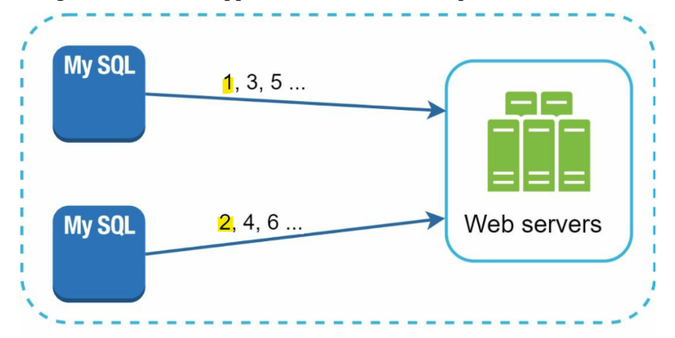
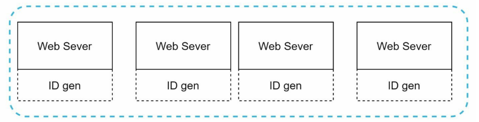

# System Design - Unique ID generator

[Back](../system_design.md)

- [System Design - Unique ID generator](#system-design---unique-id-generator)
  - [Unique ID generator](#unique-id-generator)
  - [Step 1 - Understand the problem and establish design scope](#step-1---understand-the-problem-and-establish-design-scope)
  - [Step 2 - Propose high-level design and get buy-in](#step-2---propose-high-level-design-and-get-buy-in)
    - [Multi-master replication](#multi-master-replication)
    - [UUID](#uuid)
    - [Ticket Server](#ticket-server)
    - [Twitter snowflake approach](#twitter-snowflake-approach)
  - [Step 3 - Design deep dive](#step-3---design-deep-dive)
  - [Step 4 - Wrap](#step-4---wrap)

---

## Unique ID generator

## Step 1 - Understand the problem and establish design scope

- Question:
  - What are the characteristics of unique IDs?
  - For each new record, does ID increment by 1?
  - Do IDs only contain numerical values?
  - What is the ID length requirement?
  - What is the scale of the system?

requirements are listed as follows:

- IDs must be unique.
- IDs are numerical values only.
- IDs fit into 64-bit.
- IDs are ordered by date.
- Ability to generate over 10,000 unique IDs per second.

---

## Step 2 - Propose high-level design and get buy-in

- options
  - Multi-master replication
  - Universally unique identifier (UUID)
  - Ticket server
  - Twitter snowflake approach

### Multi-master replication

- uses the databases’ auto_increment feature.
  - increase it by k, where k is the number of database servers in use.

- drawbacks:
  - Hard to scale with multiple data centers
  - IDs do not go up with time across multiple servers.
  - It does not scale well when a server is added or removed.

---

### UUID

- UUID:
  - a 128-bit number used to identify information in computer systems.

- each web server contains an **ID generator**, and a web server is responsible for generating IDs independently.
- Pros:
  - Generating UUID is simple. **No coordination between servers** is needed so there will not be any synchronization issues.
  - The system is easy to scale because each web server is responsible for generating IDs they consume. ID generator can easily scale with web servers.
- Cons:
  - IDs are 128 bits long, but our requirement is 64 bits.
  - IDs do **not go up with time**.
  - IDs could be non-numeric.

---

### Ticket Server

- use a centralized auto_increment feature **in a single database server** (Ticket Server).

- Pros:
  - Numeric IDs.
  - It is **easy** to implement, and it works for small to medium-scale applications.
- Cons:
  - Single point of failure.
    - Single ticket server means if the ticket server goes down, all systems that depend on it will face issues. To avoid a single point of failure, we can set up multiple ticket servers. However, this will introduce new challenges such as data synchronization.

---

### Twitter snowflake approach

- divide an ID into different sections.

| 1 bit | 41 bits    | 5 bits        | 5 bits     | 12 bits         |
| ----- | ---------- | ------------- | ---------- | --------------- |
| 0     | timestampe | datacenter ID | machine ID | sequence number |

- Sign bit:
  - 1 bit.
  - It will always be 0. This is reserved for future uses. It can potentially be used to distinguish between signed and unsigned numbers.
- Timestamp:
  - 41 bits.
  - Milliseconds since the epoch or custom epoch. We use Twitter snowflake default epoch 1288834974657, equivalent to Nov 04, 2010, 01:42:54 UTC.
- Datacenter ID:
  - 5 bits, which gives us 2 ^ 5 = 32 datacenters.
- Machine ID:
  - 5 bits, which gives us 2 ^ 5 = 32 machines per datacenter.
- Sequence number:
  - 12 bits. For every ID generated on that machine/process, the sequence number is **incremented by 1**. The number is reset to 0 every millisecond.

---

## Step 3 - Design deep dive

- Sequence number
  - Sequence number is 12 bits, which give us 2 ^ 12 = 4096 combinations.
  - support a maximum of 4096 new IDs per millisecond

---

## Step 4 - Wrap

- different approaches
  - multimaster replication,
  - UUID,
  - ticket server,
  - and Twitter snowflake-like unique ID generator

- additional talking points
  - Clock synchronization.
    - assume ID generation servers have the same clock.
  - Section length tuning.
    - For example, fewer sequence numbers but more timestamp bits are effective for low concurrency and long-term applications.
  - High availability.
    - Since an ID generator is a mission-critical system, it must be highly available.
