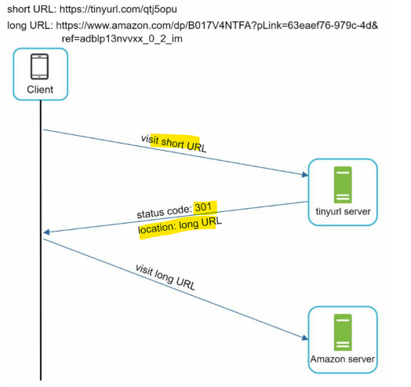
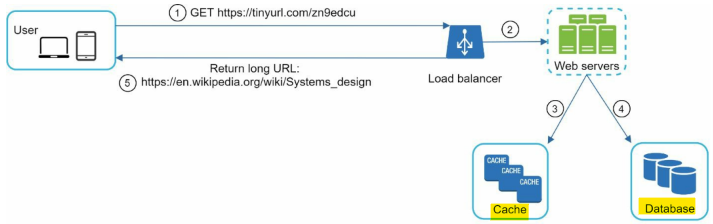

# System Design - URL shortening service

[Back](../system_design.md)

- [System Design - URL shortening service](#system-design---url-shortening-service)
  - [URL shortening service](#url-shortening-service)
  - [Step 1 - Understand the problem and establish design scope](#step-1---understand-the-problem-and-establish-design-scope)
  - [Step 2 - Propose high-level design and get buy-in](#step-2---propose-high-level-design-and-get-buy-in)
    - [API Endpoints](#api-endpoints)
    - [URL redirecting](#url-redirecting)
    - [URL shortening](#url-shortening)
  - [Step 3 - Design deep dive](#step-3---design-deep-dive)
    - [Data model](#data-model)
    - [Hash function](#hash-function)
    - [URL shortening deep dive](#url-shortening-deep-dive)
    - [URL redirecting deep dive](#url-redirecting-deep-dive)
    - [Step 4 - Wrap up](#step-4---wrap-up)

---

## URL shortening service

## Step 1 - Understand the problem and establish design scope

- Q:
  - Can you give an example of how a URL shortener work?
  - What is the traffic volume?
    - 100 million URLs are generated per day.
  - How long is the shortened URL?
  - What characters are allowed in the shortened URL?
  - Can shortened URLs be deleted or updated?

- estimation
  - Write operation: 100 million URLs are generated per day.
    - Write operation per second: 100 million / 24 /3600 = 1160
  - Read operation: Assuming ratio of read operation to write operation is 10:1, read operation per second: 1160 \* 10 = 11,600
  - Assuming the URL shortener service will run for 10 years, this means we must support 100 million \* 365 \* 10 = 365 billion records.
  - Assume average URL length is 100.
    - Storage requirement over 10 years: 365 billion _ 100 bytes _ 10 years = 365 TB

## Step 2 - Propose high-level design and get buy-in

- the API endpoints, URL redirecting, and URL shortening flows.

### API Endpoints

- design the APIs REST-style
- 1.URL shortening.
  - To create a new short URL, a client sends a POST request, which contains one parameter: the original long URL.
  - `POST api/v1/data/shorten`
    - request parameter: `{longUrl: longURLString}`
    - return `shortURL`
- 2.URL redirecting.
  - To redirect a short URL to the corresponding long URL, a client sends a GET request.
  - `GET api/v1/shortUrl`
    - Return `longURL` for HTTP redirection

### URL redirecting

- communication between clients and servers:

- 301 redirect.
  - **permanently** moved to the long URL.
  - the browser caches the response.
  - subsequent requests for the same URL will not be sent to the URL shortening service.
- 302 redirect.
  - **temporarily** moved to the long URL
  - subsequent requests for the same URL will be sent to the URL shortening service first.

---

### URL shortening

- hash function must satisfy the following requirements:
  - Each longURL must be hashed to one hashValue.
  - Each hashValue can be mapped back to the longURL.

---

## Step 3 - Design deep dive

- data model, hash function, URL shortening and URL redirecting.

---

### Data model

- A better option is to store `<shortURL, longURL>` mapping in a relational database

| Colume   | description |
| -------- | ----------- |
| id       |             |
| shortURL |             |
| longURL  |             |

---

### Hash function

- Hash value length
  - hashValue consists of characters from [0-9, a-z, A-Z], containing 10 + 26 + 26 = 62
  - if length is n, then maximal number of URLs it can support:
    - 62^n
    - n =7, supports ~3.5 trillion

- Hash + collision resolution
  - common hash functions: CRC32, MD5, or SHA-1
    - drawback: > 7
  - solved by Base 62 conversion
    - depends on unique ID generator
    - no collicsion as UID

---

### URL shortening deep dive

- as Base 62 conversion is chosen
  - process:
    - post input longURL -> gen ID -> shortURL -> save -> return shortURL

---

### URL redirecting deep dive

---

### Step 4 - Wrap up

- additional talking points
  - Rate limiter
  - Web server scaling
  - Database scalin
  - Analytics
  - Availability, consistency, and reliability
