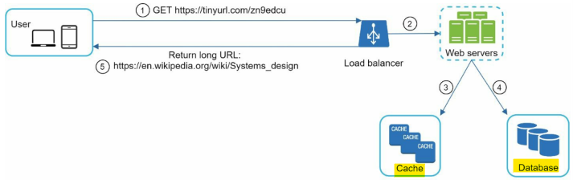

# System Design - URL shortening service

[Back](../system_design.md)

- [System Design - URL shortening service](#system-design---url-shortening-service)
  - [URL shortening servic](#url-shortening-servic)
  - [Steps](#steps)
    - [Step 1 - Requirements](#step-1---requirements)
    - [Estimation](#estimation)
    - [Step 2 - API Design](#step-2---api-design)
    - [Step 3 - Data Model](#step-3---data-model)
    - [Step 4 - High-level design](#step-4---high-level-design)
    - [Step 5 - Detailed design](#step-5---detailed-design)
      - [Hash function](#hash-function)
      - [URL redirecting deep dive](#url-redirecting-deep-dive)
    - [Step 6 - Wrap up](#step-6---wrap-up)

---

## URL shortening servic

- `URL shortening`
  - create shorter aliases, named short links, for long URLs.
  - Users are redirected to the original URL when they hit these short links.

- benefit
  - save a lot of space when displayed, printed, messaged, or tweeted.
  - optimize links across devices, tracking individual links to analyze audience and campaign performance, and hiding affiliated original URLs.

---

## Steps

### Step 1 - Requirements

- Q:
  - Can you give an example of how a URL shortener work?
  - What is the traffic volume?
  - How long is the shortened URL?
  - What characters are allowed in the shortened URL?
  - Can shortened URLs be deleted or updated?

---

- **Functional Requirements**:
  1. Given a URL, our service should generate a shorter and unique alias of it. This is called a short link.
  2. When users access a short link, our service should redirect them to the original link.
  3. Users should optionally be able to pick a custom short link for their URL.
  4. Links will expire after a standard default timespan. Users should be able to specify the expiration time.

- **Non-Functional Requirements:**
  1. The system should be **highly available**. This is required because, if our service is down, all the URL redirections will start failing.
  2. URL redirection should happen in real-time with **minimal latency**.
  3. Shortened links should not be guessable (not predictable).

- **Extended Requirements:**
  1. Analytics; e.g., how many times a redirection happened?
  2. Our service should also be accessible through REST APIs by other services.

- **Capacity**
  - 100:1 ratio between read and write
  - 500M **new** URL shortenings per month

---

### Estimation

- **read/redirection**: 100 \* 500M => 50B
- **qps write**: 500M / (30 days \* 24 hours \* 3600 seconds) = ~200 URLs/s
- **qps read**: 100 \* 200 URLs/s = 20K/s
- **Storage**:
  - total urls: 500 million \* 5 years \* 12 months = 30 billion
  - assumed 500 bytes per url: 30 billion \* 500 bytes = 15 TB
- **Bandwidth**
  - **write/incoming**: 200 \* 500 bytes = 100 KB/s
  - **read/outgoing**: 20K \* 500 bytes = ~10 MB/s
- **Memory**(if cache)
  - **read request per day**: 20K \* 3600 seconds \* 24 hours = ~1.7 billion
  - **assumed 20% are hot url** to be cached: 0.2 \* 1.7 billion \* 500 bytes = ~170GB

---

### Step 2 - API Design

- Feature: generate short link
  - `POST /api/v1/url`
  - param:
    - api-token
    - long-url
    - expire-time: option
  - return:
    - short-link
    - 200
- Feature: get short link
  - `GET /api/v1/url`
  - param:
    - api-token
    - long-url
  - return:
    - short-link
    - 301/302
- Feature: expire short link
  - `DELETE /api/v1/url`
  - param:
    - api-token
    - url-id
  - return:
    - none
    - 200

---

### Step 3 - Data Model

for all urls

| feild     | Datatype | description     |
| --------- | -------- | --------------- |
| uuid      | num      | unique id       |
| long-url  | varchar  | long url        |
| short-url | varchar  | short url       |
| expired   | boolean  | whether expired |

for user urls

| feild   | datatype | description |
| ------- | -------- | ----------- |
| user_id | int      | user id     |
| url_id  | int      | url id      |

nosql: key-value

---

### Step 4 - High-level design

client -> LB -> web server -> database

- Evaluate: generate short url
- Evaluate: get short url

---

### Step 5 - Detailed design

- Database
  - data partition
    - **hashing function** will **randomly distribute** URLs into different partitions

- Cache
  - cache eviction policy: `Least Recently Used (LRU)` discard the least recently used URL first

- LB
  - between client and app server
  - between app server and caches
  - between app server and db

- Flowchart
  - POST: client -> lb -> web server (authen) -> app server -> DB -> return shorten url
  - GET: client -> LB -> web server (authen) -> app server -> cache
    - -> if exists, return shorten url
    - -> if not exists, read DB -> write cache -> return short url

- expired:
  - backend clean up

- Telemetory & Analytics:
  - aggregate: user location; hot urls

- Seurity:
  - api key: authen

---

#### Hash function

- Hash value length
  - hashValue consists of characters from [0-9, a-z, A-Z], containing 10 + 26 + 26 = 62
  - if length is n, then maximal number of URLs it can support:
    - 62^n
    - n =7, supports ~3.5 trillion

- Hash + collision resolution
  - common hash functions: CRC32, MD5, or SHA-1
    - drawback: > 7
  - solved by Base 62 conversion
    - depends on unique ID generator
    - no collicsion as UID

---

#### URL redirecting deep dive

---

### Step 6 - Wrap up

- functional
  - generate
  - get
- non-functional
  - scale/performance: rqs, cache
  - reliability/avalialbility: lb, nosql
  - security
