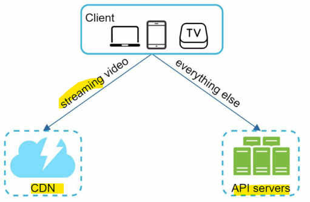
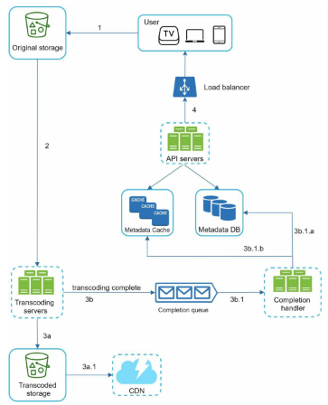
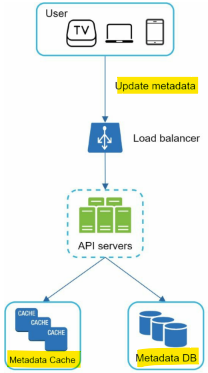
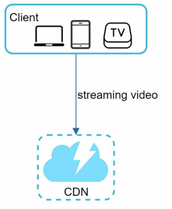
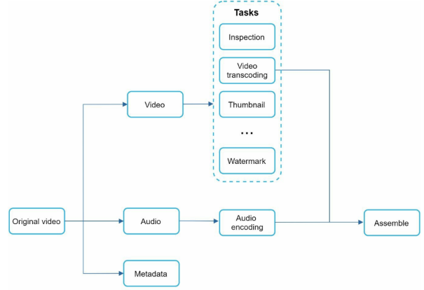
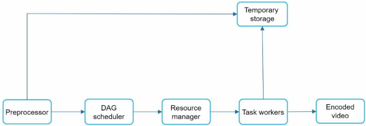

# System Design - YouTube

[Back](../system_design.md)

- [System Design - YouTube](#system-design---youtube)
  - [YouTube](#youtube)
  - [Step 1 - Understand the problem and establish design scope](#step-1---understand-the-problem-and-establish-design-scope)
  - [Step 2 - Propose high-level design and get buy-in](#step-2---propose-high-level-design-and-get-buy-in)
    - [Video uploading flow](#video-uploading-flow)
    - [Video streaming flow](#video-streaming-flow)
    - [Step 3 - Design deep dive](#step-3---design-deep-dive)
    - [Video transcoding](#video-transcoding)
    - [Directed acyclic graph (DAG) model](#directed-acyclic-graph-dag-model)
    - [Video transcoding architecture](#video-transcoding-architecture)
  - [Step 4 - Wrap up](#step-4---wrap-up)

---

## YouTube

- video sharing platform
  - e.g., YouTube, Netflix, Hulu

## Step 1 - Understand the problem and establish design scope

- Q:
  - What features are important?
    - Ability to upload a video and watch a video.
  - What clients do we need to support?
    - Mobile apps, web browsers, and smart TV
  - How many daily active users do we have?
    - 5 million
  - What is the average daily time spent on the product?
    - 30 minutes
  - Do we need to support international users?
    - Yes, a large percentage of users are international users.
  - What are the supported video resolutions?
    - The system accepts most of the video resolutions and formats.
  - Is encryption required?
    - Yes
  - Any file size requirement for videos?
    - Our platform focuses on small and medium-sized videos. The maximum allowed video size is 1GB.
  - Can we leverage some of the existing cloud infrastructures provided by Amazon, Google, or Microsoft?
    - That is a great question. Building everything from scratch is unrealistic for most companies, it is recommended to leverage some of the existing cloud services.

- features
  - Ability to **upload** videos **fast**
  - Smooth video **streaming**
  - Ability to change video **quality**
  - Low infrastructure **cost**
  - High availability, scalability, and reliability requirements
  - Clients supported: mobile apps, web browser, and smart TV

- estimation
  - Assume the product has **5 million** `daily active users (DAU)`.
  - Users watch **5 videos** per day.
  - **10%** of users upload 1 video per day.
  - Assume the average video size is **300 MB**.
  - Total daily storage space needed: 5 million \* 10% \* 300 MB = 150TB

- CDN cost.
  - When **cloud CDN** serves a video, you are charged for **data transferred** out of the CDN.
  - Let us use Amazon’s CDN CloudFront for cost estimation.
    - Assume 100% of traffic is served from the United States. The average cost per GB is $0.02.
  - For simplicity, we only calculate the cost of video streaming.
    - 5 million \* 5 videos \* 0.3GB \* $0.02 = $150,000 per day.

---

## Step 2 - Propose high-level design and get buy-in

- streamed from the CDN
- API servers:
  - feed recommendation, generating video upload URL, updating metadata database and cache, user signup, etc.

- two flows:
  - Video uploading flow
  - Video streaming flow

---

### Video uploading flow

- Flow a: upload the actual video

1. Videos are **uploaded** to the original storage.
2. `Transcoding servers` fetch videos from the original storage and **start transcoding**.
3. Once transcoding is complete, the following two steps are executed in parallel:
   3a. Transcoded videos are **sent** to `transcoded storage`.
   3a.1. Transcoded videos are **distributed** to `s`.
   3b. Transcoding completion **events** are queued in the `completion queue`.
   3b.1. `Completion handler` contains a bunch of workers that continuously **pull** event data from the queue.
   3b.1.a. and 3b.1.b. `Completion handler` updates the metadata database and cache when svideo transcoding is complete.
4. API servers **inform** the client that the video is successfully uploaded and is ready for streaming.

---

- Flow b: update the metadata

---

### Video streaming flow

- streaming protocol
- To lower latency, Videos are streamed from CDN directly. The edge server closest to you will deliver the video.

--

### Step 3 - Design deep dive

### Video transcoding

- Why
  - Many devices and browsers only support certain types of video formats. Thus, it is important to encode a video to different formats for compatibility reasons.
  - To ensure users watch high-quality videos while maintaining smooth playback, it is a good idea to deliver **higher resolution** video to users who have **high network bandwidth** and **lower resolution** video to users who have **low bandwidth**.
  - switching video quality automatically or manually based on network conditions is essential for smooth user experiencess

---

### Directed acyclic graph (DAG) model

---

### Video transcoding architecture

---

## Step 4 - Wrap up

- additional points
  - Scale the API tier: Because API servers are stateless, it is easy to scale API tier horizontally.
  - Scale the database: You can talk about database replication and sharding.
  - Video takedowns: Videos that violate copyrights, pornography, or other illegal acts shall be removed.
    s
